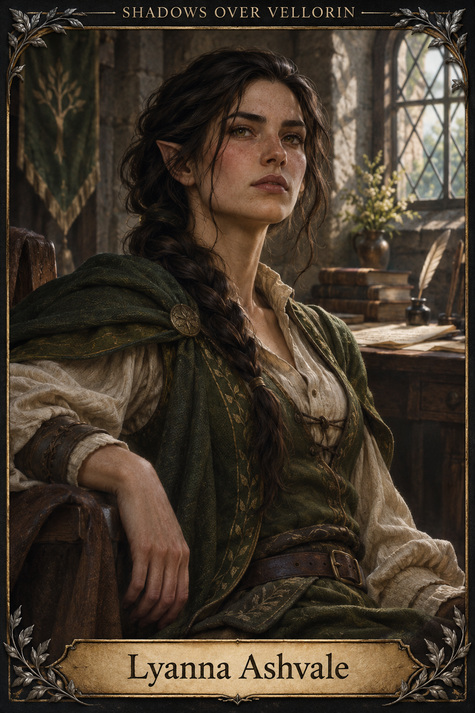
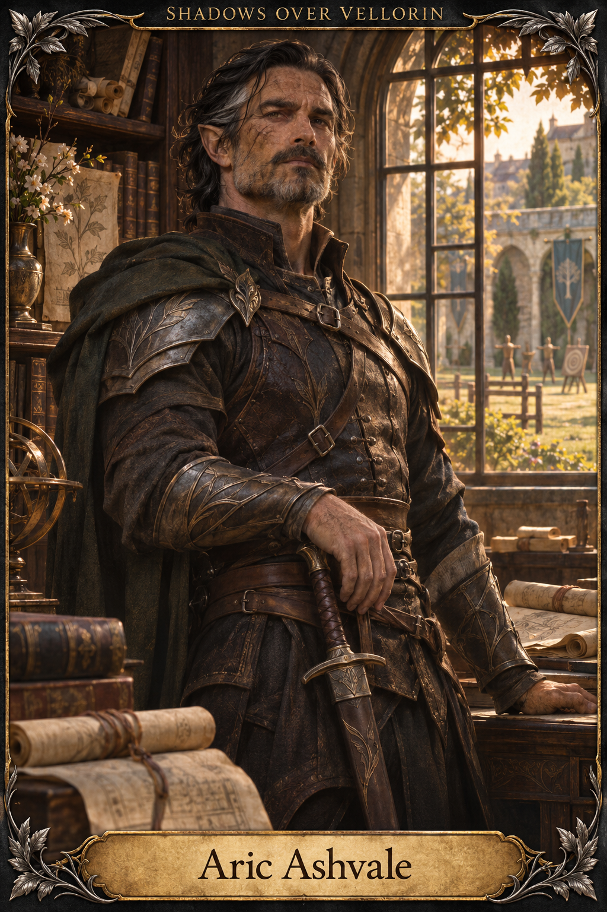
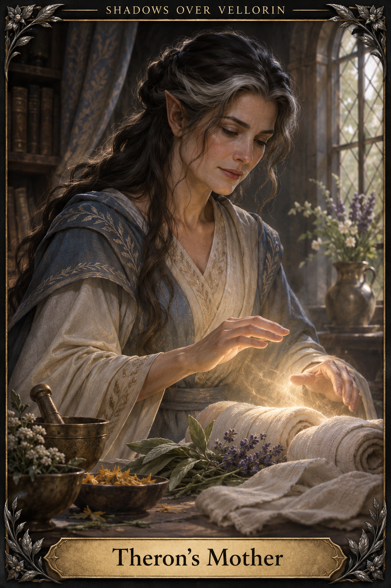
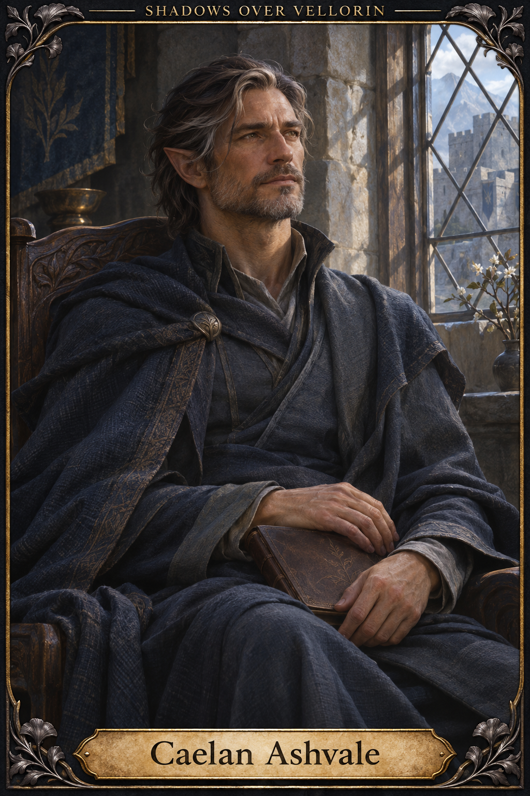
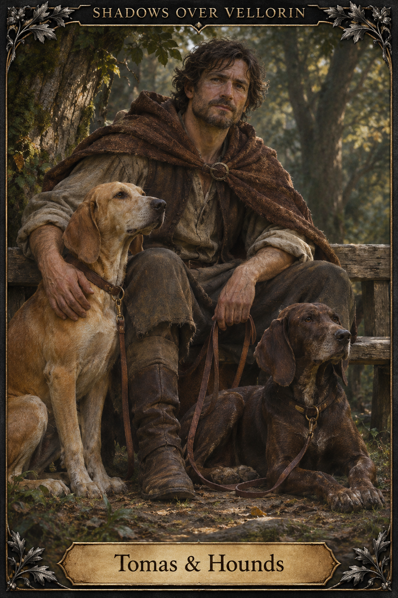

# Family and Tomas

[Artwork index](../README.md)

All unspecified visual details are artistic interpretations; see the artwork index for canon boundaries.

## Lyanna Ashvale

Theron’s younger sister; independent survivor. Appearance is interpreted.

Sources: [lyanna-ashvale](../../entities/characters/lyanna-ashvale.md)

## Aric Ashvale

Theron’s father, former adventurer and A-rank swordsman. Appearance is interpreted.

Sources: [aric-ashvale](../../entities/characters/aric-ashvale.md)

## Theron’s Mother

Theron’s unnamed mother, rare sacred healer. Name remains unknown; appearance and depiction of healing are interpreted. The current Aric record supersedes older uncertainty about her whereabouts.

Sources: [aric-ashvale](../../entities/characters/aric-ashvale.md), [07-7-the-ashvale-family](../../archive/legacy-modules/world/07-7-the-ashvale-family.md)

## Caelan Ashvale

Theron’s uncle, recovering at last verified report. Appearance is interpreted.

Sources: [caelan-ashvale](../../entities/characters/caelan-ashvale.md)

## Tomas & Hounds

Tomas with exactly two hunting hounds. Faces, coats and setting are interpreted; this portrait does not establish current location or custody.

Sources: [tomas](../../entities/characters/tomas.md), [hounds-tomas](../../entities/creatures/hounds-tomas.md)

