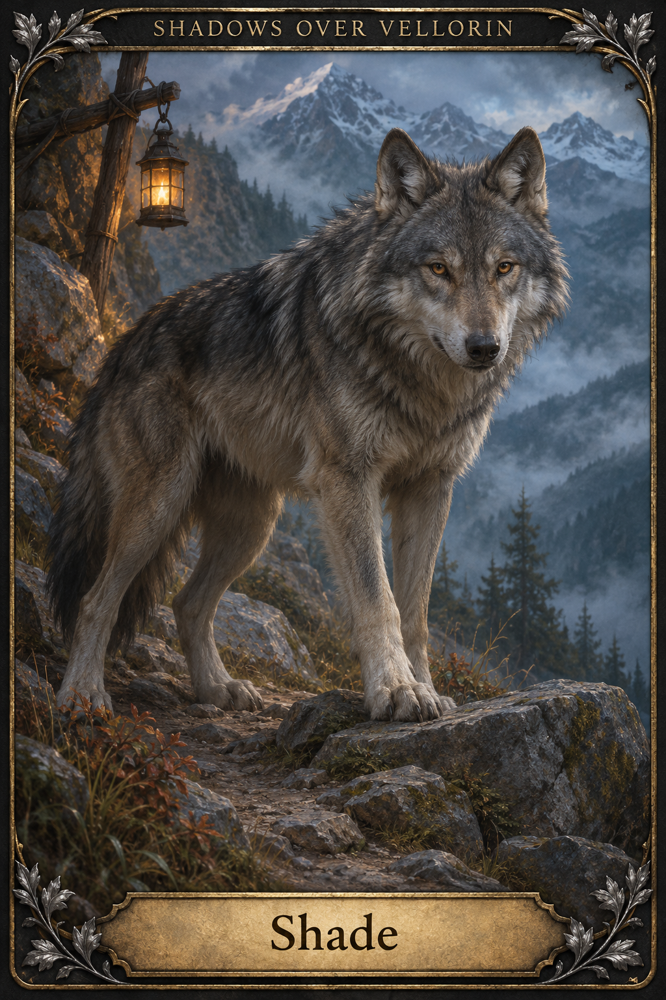
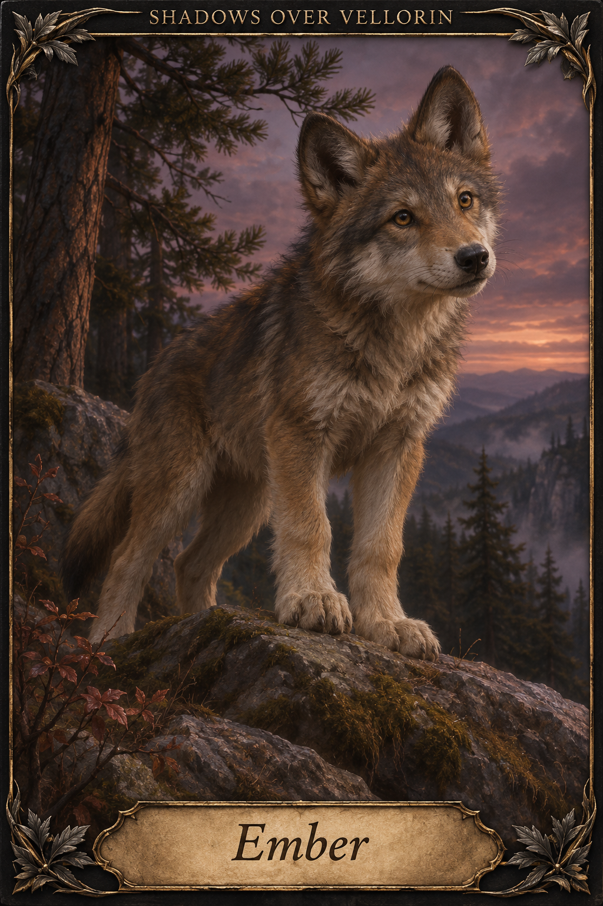
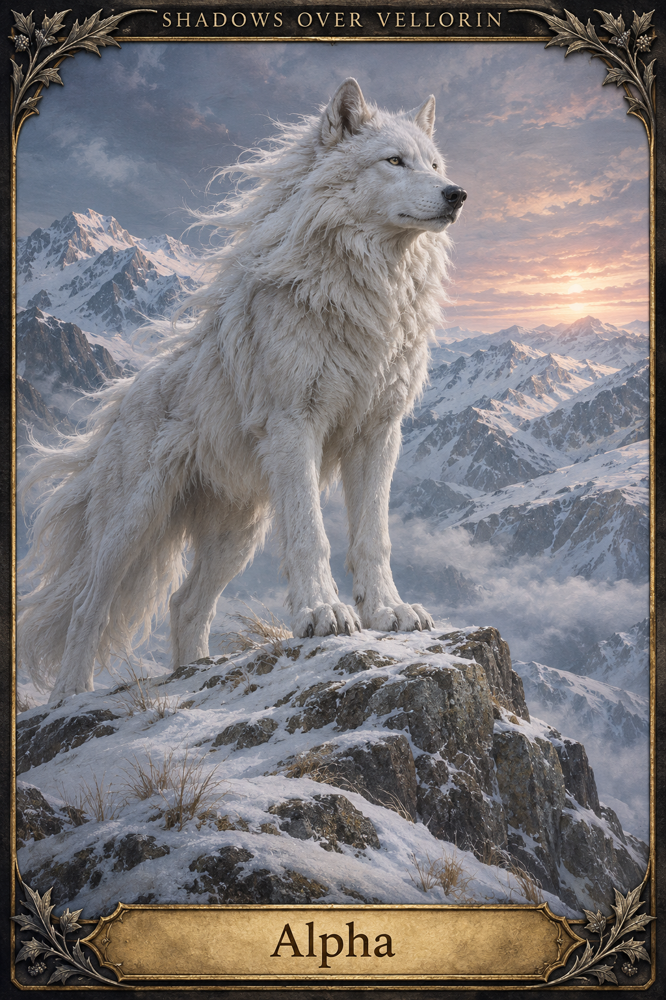
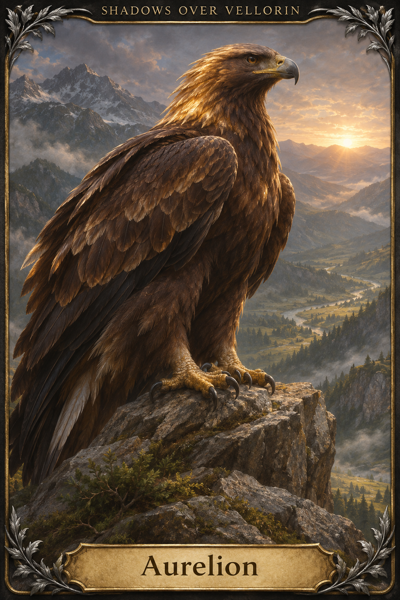
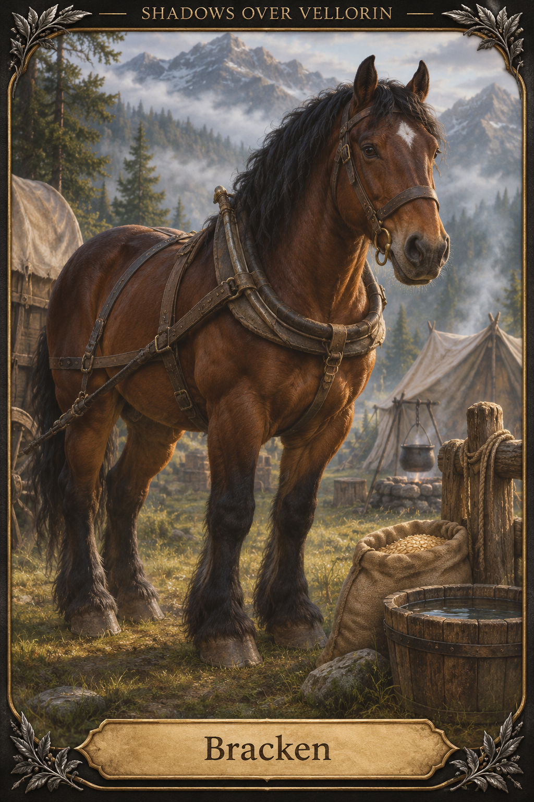
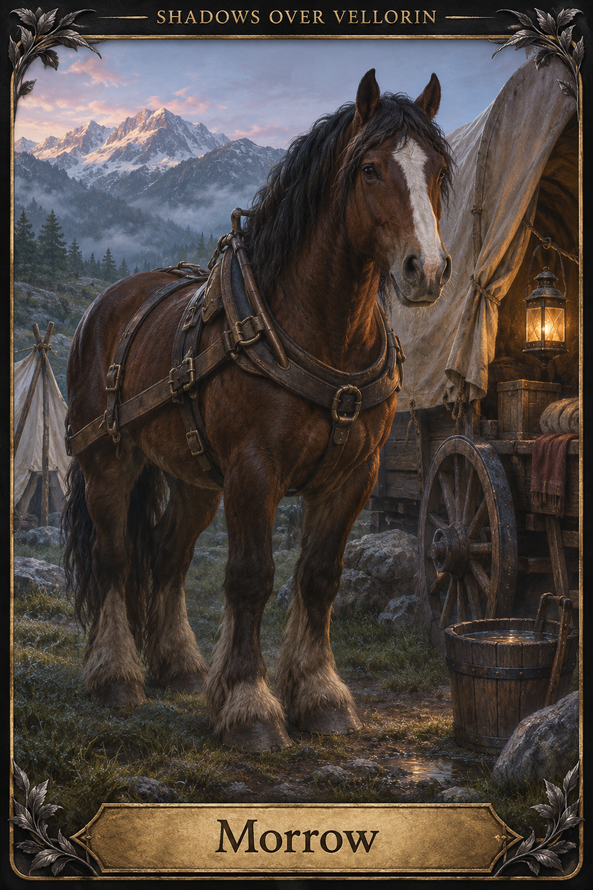

# Animal companions

[Artwork index](../README.md)

All unspecified visual details are artistic interpretations; see the artwork index for canon boundaries.

## Shade

Theron’s bonded gray wolf. Dedicated companion portrait.

Sources: [shade](../../entities/creatures/shade.md)

## Ember

Nyx’s bonded wolf. Warm brown-gray coat follows the earlier art interpretation, not a newly established canon trait.

Sources: [ember](../../entities/creatures/ember.md)

## Alpha

Independent white Frostfang alpha wolf; not owned or magically bound.

Sources: [alpha](../../entities/creatures/alpha.md)

## Aurelion

Golden eagle; portrait does not establish current location or bond changes.

Sources: [aurelion](../../entities/creatures/aurelion.md)

## Bracken

Expedition wagon horse. Bay coat and small forehead star are artistic choices.

Sources: [bracken](../../entities/creatures/bracken.md)

## Morrow

Expedition wagon horse. Dark brown coat and broad blaze are artistic choices.

Sources: [morrow](../../entities/creatures/morrow.md)

