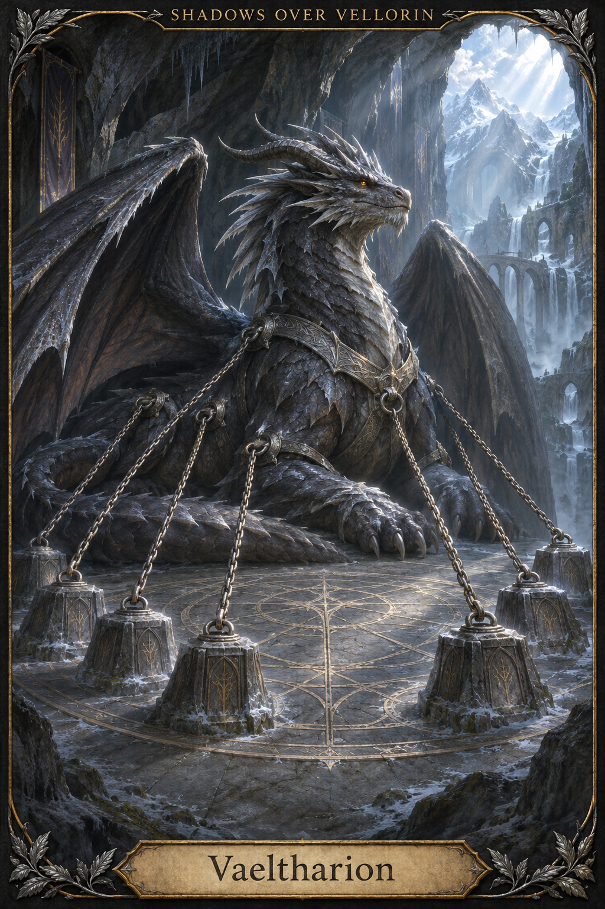

# Dragons

[Artwork index](../README.md)

All unspecified visual details are artistic interpretations; see the artwork index for canon boundaries.

## Vaeltharion

Ancient black-steel/silver-frost dragon with amber eyes, depicted with seven attached foundation chains in Hollow Veil. Harness, cavern architecture and anchor arrangement are interpretations. Independent allied guardian.

Sources: [vaeltharion](../../entities/creatures/vaeltharion.md)

**Historical phase:** Vaeltharion’s illustration shows the earlier attached-chain state. The Day153 written record supersedes it: all seven coercive chains removed, seven protective anchors retained. The image does not override current canon.
