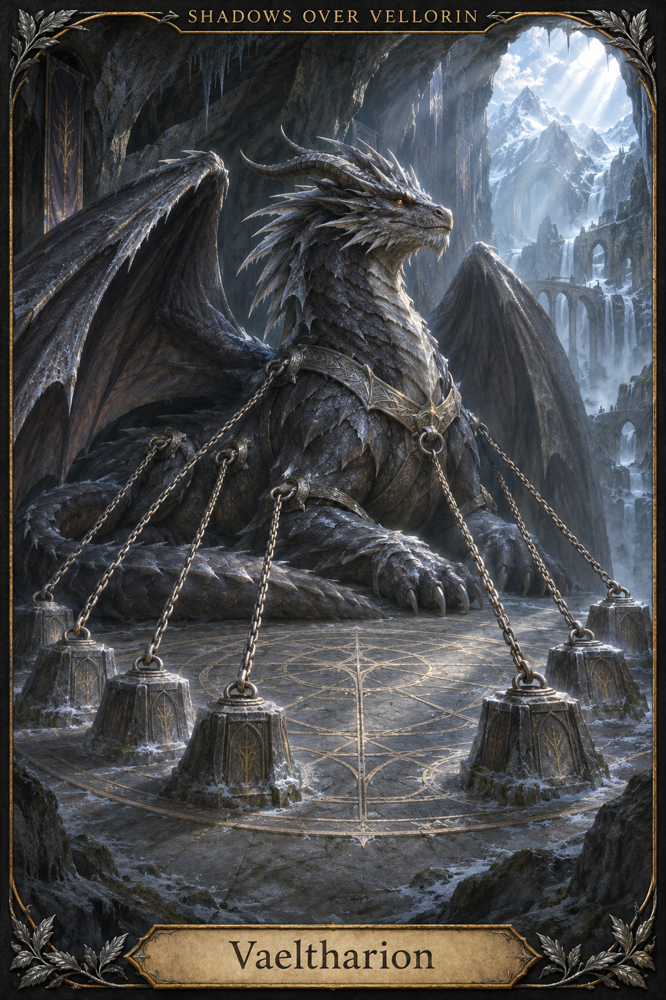

# Dragons

[Artwork index](../README.md)

All unspecified visual details are artistic interpretations; see the artwork index for canon boundaries.

## Vaeltharion

Ancient black-steel/silver-frost dragon with amber eyes, depicted with seven attached foundation chains in Hollow Veil. Harness, cavern architecture and anchor arrangement are interpretations. Independent allied guardian.

Sources: [vaeltharion](../../entities/creatures/vaeltharion.md)

**Historical phase:** Vaeltharion’s illustration shows the earlier attached-chain state. The Day153 written record supersedes it: all seven coercive chains removed, seven protective anchors retained. The image does not override current canon.

## Humanoid reference designs

See the [six humanoid profiles](../../entities/creatures/dragon-humanoid-forms.md) and [copy-ready image prompts](../../entities/mechanics/dragon-image-reference-prompts.md). The profiles track the player-reported Aurelith scene and the approval status of each design.

Future portraits can use the existing dragon directory and each dragon’s entity ID followed by `-humanoid.png`. Vaeltharion’s existing illustration remains the historical natural-form reference.
