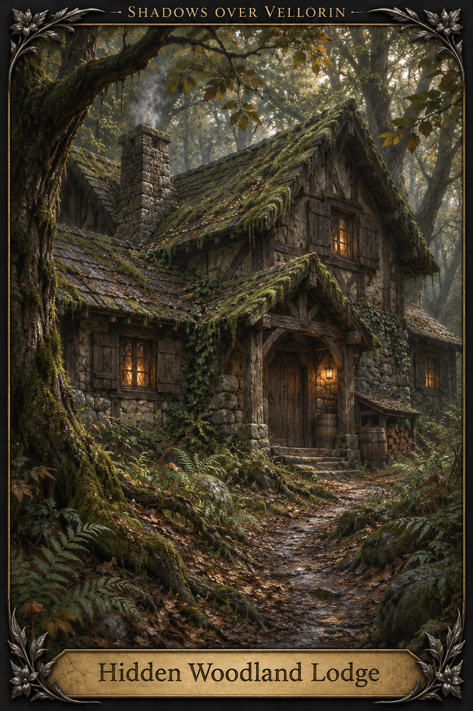
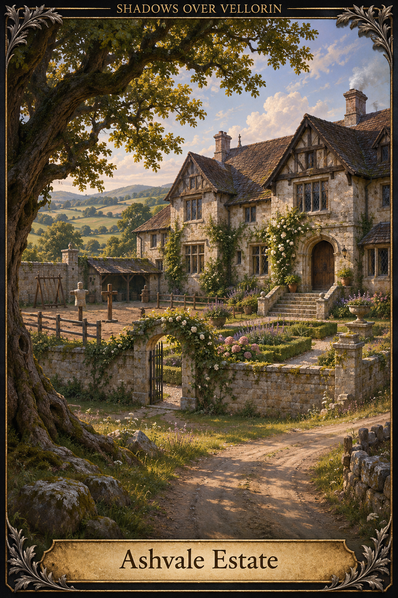
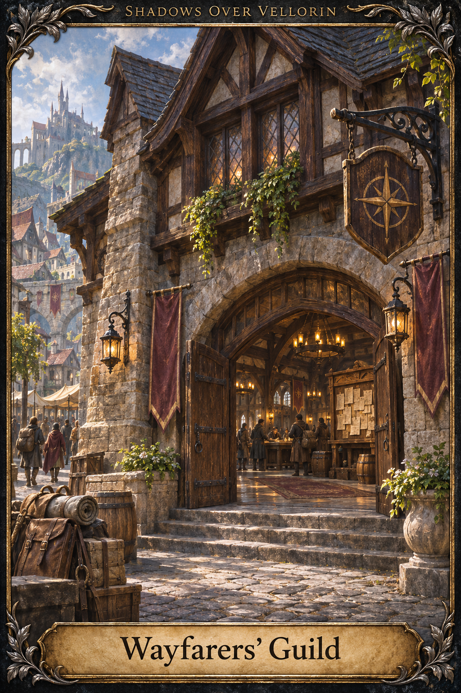

# Places

[Artwork index](../README.md)

All unspecified visual details are artistic interpretations; see the artwork index for canon boundaries.

## Hidden Woodland Lodge

Hidden lodge in the Eastrun/Briarfall woodland area. Exterior architecture and furnishings are concept design.

Sources: [briarfall-crossing](../../entities/locations/briarfall-crossing.md)

## Ashvale Estate

Ashvale family ancestral holding. Manor design, landscaping and courtyard layout are interpretations.

Sources: [ashvale-estate](../../entities/locations/ashvale-estate.md)

## Wayfarers’ Guild

Concept for the Wayfarers’ Guild headquarters in Caelthorne. Architecture and compass-style sign are proposed visual designs, not established heraldry.

Sources: [06-6-guilds-factions-and-local-operations](../../archive/legacy-modules/world/06-6-guilds-factions-and-local-operations.md)

