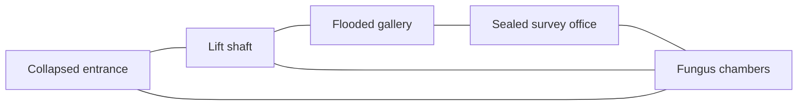
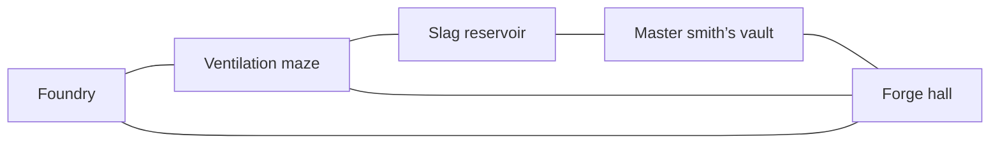
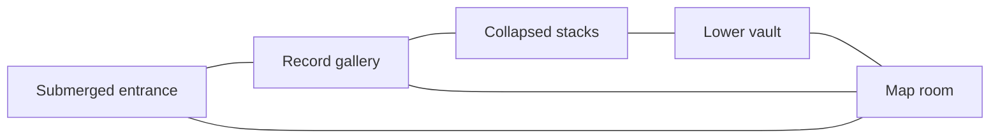
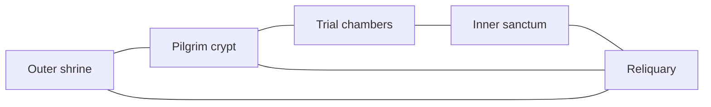
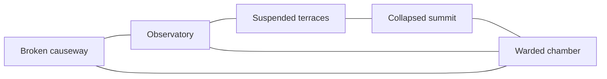

# Approved dungeon and exploration designs — Phase 2 PR 5

This guide routes five approved public design profiles, not active dungeon instances or a player-discovery map. Each is an indexed mechanics owner, linked exactly once from its original dungeon-proposal ID. No location or creature entity, entrance, road, surveyed area, populated encounter, current hazard, loot cache or quest result is created. Existing historical dungeon-registry, exploration-sections, creature, salvage, evidence and finance owners remain unchanged.

APPROVED DESIGN classifies fictional architecture/history and procedures. PROPOSED classifies candidate geography, encounters and monster references. Actual discovery, passability, occupants, source energy, current section states, recoverable contents and player knowledge remain unknown. Reference retrieval is no scene, action or automatic discovery. Historical played canon always retains precedence.

## Five-dungeon inventory and rank boundary

| Indexed mechanics owner | Original proposal ID | Candidate region | Design difficulty |
|---|---|---|---|
| [hollowstone-mine](../entities/mechanics/hollowstone-mine.md) | `dungeon-proposal:hollowstone-mine` | Stoneford quarry hills; exact hillside, land title and approach unsurveyed. | D reference |
| [ashen-anvil](../entities/mechanics/ashen-anvil.md) | `dungeon-proposal:ashen-anvil` | Abandoned mountain workings in Ironhollow Holds; no precise ridge, entrance or ownership established. | B reference |
| [drowned-archive](../entities/mechanics/drowned-archive.md) | `dungeon-proposal:drowned-archive` | Candidate ruined civic archive beneath a proposed Rivermere canal district; no surveyed canal, building or navigable entrance. | A reference |
| [pale-reliquary](../entities/mechanics/pale-reliquary.md) | `dungeon-proposal:pale-reliquary` | Isolated northern highland sanctuary; not placed in Frostmarch, Frostspire or another known site. | S reference |
| [shattered-meridian](../entities/mechanics/shattered-meridian.md) | `dungeon-proposal:shattered-meridian` | Isolated mountain plateau; exact location, approach and relation to other observatories unknown. | Legacy SS, mapping unresolved |

The old proposed dungeon scale remains F/E/D/C/B/A/S/S+; it is not extended by this PR. Shattered Meridian’s original SS proposal is preserved, with no compatible_rank or silent S+ substitution. Existing combat, guild-license, professional, dungeon-threat and contract rank domains remain distinct. D/B/A/S labels are design references, not certified combat balance or historical encounter ratings. PR 8 retains final monster/combat integration.

Hollowstone’s abandoned mining, moist fungal system and finite tools/record possibilities do not establish an ore deposit, operating mine or dated closure event. Ashen Anvil’s old forge/heat/control architecture does not produce an active furnace, blueprint or weapon. Drowned Archive’s former civic use/flood damage produces no authenticated map, contract, conspiracy evidence or breathable air pocket. Pale Reliquary’s ceremonial architecture produces no named order, legendary artifact, existing guardian identity or hidden mystery link. Shattered Meridian’s astronomical/disaster history is approved fiction, not a discovered historical revelation or temporal/spatial ability.

No shared name/theme merges these designs with the two Hollows, Old Copperworks, existing Depository/receiving chambers, Pale Devourer, Winter Warden or prior observatories. Original proposal collision reviews remain intact. The historical 18 site/context and 14 section records are untouched.

## Bounded area topology and retreat

Each design contains five named areas and six physical connection models, for 25 areas/30 connections total. These are finite schematic architectural relationships, never surveyed geometry, discovered doors, secret solutions or guaranteed traversable corridors. Every edge has unverified current passability and conditions for support, air/water/heat, access and equipment. No teleporter, hidden cache or new external entrance is added.

Two internal retreat-path designs per site return to the entry interface through different area sequences. They are options only if independently verified at the time; obstruction, water, air, heat, weather or structural damage can invalidate them. The conceptual interface is not a known surface entrance, safe air, actual exit or guaranteed rescue route. Additional surface openings are not invented.

### Hollowstone Mine — schematic design only

Rest/access limits: Air, water, sound rock and equipment must be verified. No functioning lift, breathable shaft or alternative surface exit is implied. Rest needs independently verified safe air, shelter, conditions and supplies; no free healing or mana recovery.

### Ashen Anvil — schematic design only

Rest/access limits: Cooling, ventilation and structural conditions may block all progress. No fire, forge, lift or ward is automatically operating or restored. Rest needs independently verified safe air, shelter, conditions and supplies; no free healing or mana recovery.

### Drowned Archive — schematic design only

Rest/access limits: No air pocket is guaranteed breathable or replenishing. Water pressure, fragile records, return navigation and actual breathing/rescue capability constrain access. Rest needs independently verified safe air, shelter, conditions and supplies; no free healing or mana recovery.

### Pale Reliquary — schematic design only

Rest/access limits: Local cultural rights and consent may preclude entry/removal. Respectful observation, dialogue if possible, documenting without taking, seeking lawful custodians and withdrawal are distinct noncombat options. Rest needs independently verified safe air, shelter, conditions and supplies; no free healing or mana recovery.

### Shattered Meridian — schematic design only

Rest/access limits: Plan more than one verified internal return path and safe stopping criteria; damaged spans, weather and distorted appearance can invalidate them. No new teleport, time shift, anchor or ability is supplied. Rest needs independently verified safe air, shelter, conditions and supplies; no free healing or mana recovery.

## Ecology and independent inhabitants

Each profile explains possible food/nutrient/water/air/refuge or supported finite-energy dependencies. Spider predators need viable prey and nests; fungi need moisture/organic nutrients; burrowers/bats/scavengers/predators need actual habitat and sustenance. Flooding needs a credible source/drainage model, with no infinite safe air. Sentinels, spirits, wards and guardians need independently verified finite energy and original purpose; no endless furnace/mana source or actual reserve is established.

Possible behaviors include hunting, territorial/nest defense, avoidance, duty, dialogue where communication is possible, negotiation, disengagement and retreat. Creatures are not compulsory attackers. Current populations, motives, hostility and resources remain unverified. No automatic respawn, scaling to Theron, revival, active population, guardian command or remote creature activity occurs. Existing independent creatures retain their original identity, consent and history.

## Monster reference compatibility

The existing ecology/hazard owner stores these five PROPOSED reference templates with the player-approved values, not active creature entities or usable opponents.

| Monster reference | HP | MP | DEF | Reference rank |
|---|---:|---:|---:|---|
| Giant Cave Spider | 24 | 0 | 12 | D |
| Fungal Burrower | 36 | 0 | 14 | D |
| Ash Sentinel | 85 | 40 | 20 | B |
| Waterbound Guardian | 110 | 80 | 23 | A |
| Ancient Reliquary Warden | 190 | 160 | 30 | S |

Compatibility review: finite nonnegative HP/MP/DEF fields fit existing resource concepts, but current creature owners supply no complete attack/damage/movement/resistance package or global balance calibration for these opponents. Attack bonus, damage formula, movement, resistances and instance counts remain null; combat_usable stays false. The reference MP values are not present reserves or a regeneration source. Existing d20/stakes/modifier/line-of-sight/concentration/morale rules, actual spells/costs/discounts and finite resources are unchanged. PR 8 must resolve final combat use without silently replacing formulas or ranks.

## Encounter and hazard coverage

Twenty-five proposed encounter designs cover exploration, stealth, resource management, environmental hazards, mechanical danger, possible creatures, communication/negotiation, moral choices, magical defenses where appropriate, rescue and retreat. Each has a bounded design-area reference, premises/options/resources, unknown population and no actual outcome. Rescue means a possible later problem during real exploration, not an invented trapped NPC. Observation, avoiding disturbance, requesting lawful help, negotiating where feasible, documenting without taking and withdrawal are meaningful choices; no check, combat or creative bypass is guaranteed.

Twelve hazard references identify trigger, observable warnings, exposure, possible consequences, mitigation, required resources, failure conditions and recovery limits. These are generic safety/design descriptions, not current trap placements, hidden mechanisms, disarm recipes or global numeric effects.

| Hazard reference | Exposure/limitation |
|---|---|
| `hazard-design:cave-in` | Occupying or loading an unstable area after local observation. Do not assume a collapse reversible or anyone unharmed; rescue needs actual access and resources. |
| `hazard-design:flooding` | Entering a wet reach without confirmed water/escape conditions. No automatic drainage, restored supplies, dry records or recovered victim. |
| `hazard-design:toxic-spores` | Actual inhalation/contact in a verified affected space. No automatic cure, diagnosis or restoration; existing healing rules apply. |
| `hazard-design:extreme-heat` | Time spent near actual heat without adequate protection/retreat. No instant cooling, free healing or unlimited tolerated exposure. |
| `hazard-design:smoke` | Inhaling or navigating actual contaminated air. No assumption smoke clears on a timer or that magical treatment is free. |
| `hazard-design:unstable-bridge` | Committing persons or loads to an unverified crossing. No automatic repair, recovered cargo or safe fall. |
| `hazard-design:collapsing-floor` | Stepping onto an actually unstable span. No floor resets or automatic rescue after collapse. |
| `hazard-design:low-oxygen` | Actual occupancy with insufficient air; pockets are never assumed safe. No infinite air pocket, automatic replenishment or free recovery. |
| `hazard-design:darkness` | Moving/working without actual adequate perception. No free lighting, automatic map or hidden-path revelation. |
| `hazard-design:magical-residue` | Actual exposure to the evidenced source under its conditions. No free neutralization, mana, new spell, ownership or guaranteed ward shutdown. |
| `hazard-design:spatial-instability` | Crossing or navigating the verified affected space. No new temporal/spatial power, free anchor, solved route or reversible distortion. |
| `hazard-design:unstable-machinery` | Actual proximity/operation in a verified danger zone. No functioning lift/forge is restored or created by a design note. |

Numerical effects/current placements remain unknown and automatic_damage is false. No HP/MP, status, time, consumable or inventory is deducted by a reference. In real authorized play, establish actual conditions and warn fairly, declare stakes/costs/consequences under existing rules, apply only supported results and preserve consequences. Proximity to a ward/disaster never grants a new spell, safe magical solution, free mana, unlocked Chronos Eye or Dragon Slayer.

## Finite treasure, salvage and legal boundaries

The exploration owner supplies ten potential reward categories (coins, tools, craft materials, mineral samples, records, mundane salvage, decorations, rare materials, research fragments and relics requiring review), an empty recovery template and procedure. Per-site category lists are finite possibilities, not seeded quantities/objects, a known treasure position, authenticated document, unclaimed deposit or legendary item. No area contains a populated reward list, and no loot budget/current stock is certified.

Every actual reward needs an established source/specific recovered location, positive finite quantity within verified availability, discovery and recovery evidence, ownership/provenance, lawful scope, carrying capacity and an approved original inventory/finance update. Unknown quantity never means unlimited, and recovery/processing never grants title. A pure completeness helper checks the supplied fields and finite quantities, with no award, roll, inventory or finance writer; source truth/permissions still require human review. Actual objects/events must remain once-only in original owners, not this template.

Respect land/mining claims, protected cultural sites, dangerous-research permissions, salvage rules and contract/guild limits under PR 3. A dungeon’s existence/rank or someone’s professional interest supplies no permit, excavation right, custody order or ownership. Sacred objects may properly remain in place; documenting or leaving are valid outcomes. Shady Salvage, Launder, protected evidence and the sole schema 4 finance ledger stay authoritative. Nothing is discovered, recovered, sold, crafted, consumed or paid here.

## Proposed guild/faction interests, travel and persistence

The profiles reference valid PR 4 professional/criminal-design IDs for potential study, conservation, records, lawful support or illicit pressure. No faction expedition, monster contract, hidden occupation/base, secret discovery or actual crime is created. In particular Nightglass, Black Pick and Thornless interests are no existing conspiracy connection or current operation. All original guild/faction files remain unchanged.

Candidate regional placement provides no coordinates, route, actual entrance or travel duration. Northern highlands and the isolated plateau are not assigned to an existing northern realm/site. Drowned Archive’s proposed canal district is not a surveyed water route. Before use require an actual source-backed lead, separate character-knowledge evidence, site/access verification and compatible approach. Archival inquiry, survey request or professional consultation are lead categories, not new clue statements, NPC replies, sent messages or completed quests.

Actual changes persist through original exploration/creature/item/quest/chronicle owners. No area resets, defeated creature respawns, cache refills, structure repairs itself, mana recharges or current state is duplicated in these design files. Existing history, resource/lock/magic rules, custody, property and all campaign state remain unchanged. No exploration occurs in this PR.

## Public repository safety

All additions are safe public reference design, not hidden dungeon solutions, secret coordinates, legendary objects, confidential outcomes, covert creature identities or undiscovered plot revelations. gm-reference is not privacy or automatic player knowledge. Repository visibility is unchanged; existing public contents are not certified spoiler-safe. See [PR 5 review](phase2-05-review.md) for inventories, unchanged-canon evidence, rank conflicts and test results.
