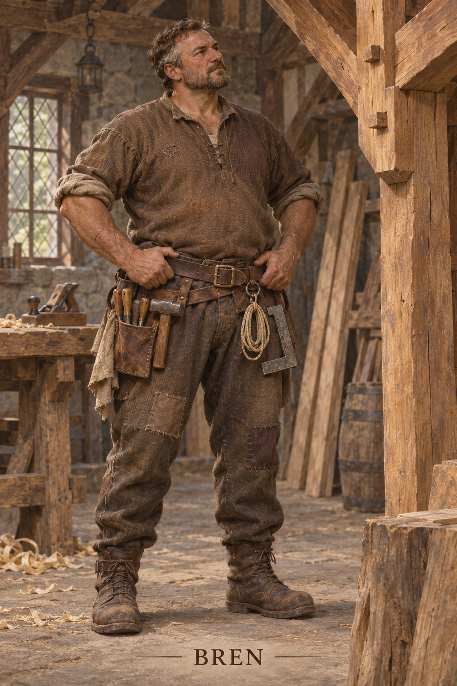

# Bren

Ashvale Lodge construction and maintenance; Tomas handles stewardship/accounting.

## Player-approved character reference design

Approved from the supplied character-sheet draft in [character-reference-design-approval](../../changes/chronicles/character-reference-design-approval.md). The appearance, clothing and mannerisms below are new reference design approved for repository use, not recovered historical observations. They do not establish a sighting, whereabouts, inventory acquisition, guilt, abilities, kinship or past action. Reference ages are design values, not a calendar advance; exact measurements not supplied below remain unspecified.

- **Recorded role and continuity:** Handles Ashvale Lodge construction and maintenance; Tomas handles stewardship and accounting.
- **Sex, ancestry, age, measurements and appearance:** Human male, 43; 5 ft 9 in, 195 lb. Broad, sturdy build, thick forearms and a modest belly. Weathered ruddy skin; square face, slightly crooked nose, hazel eyes. Short chestnut hair graying at temples; close uneven beard. Callused hands and small working scars.
- **Clothing and image-reference equipment:** Faded brown wool shirt, rolled sleeves, patched trousers, heavy boots, worn leather tool belt; measuring cord and carpenter's square.
- **Personality, mannerisms and speech:** Practical, patient, quietly proud of durable work. Studies joints and rooflines while listening; hooks thumbs into belt before an estimate. Plain speech; dislikes promises before inspection.
- **Historical gaps and boundaries:** Surname, earlier career and exact professional training.

## Character portrait

[Portrait gallery](../../artwork/character-references/README.md) · [Approved design provenance](../../changes/chronicles/character-reference-design-approval.md). Generated from the approved reference description; incidental visual details and background are artistic interpretation, not additional played facts.
