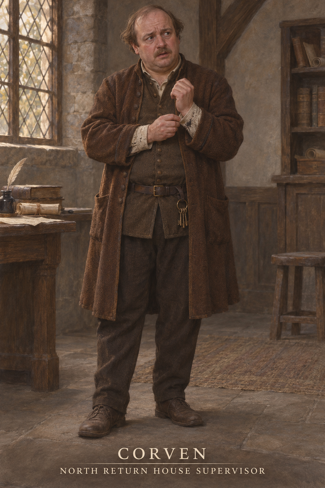

# Corven — North Return House supervisor

Lodge supervisor who surrendered, alive/unharmed under Garrick’s nonlethal guard. Mental Probe13MP disclosed limited surface thoughts of cellar ledger, blue case, western workshop’s silence and retained duplicate; connection ended on resistance, no deeper memories extracted/altered. Identified blue case behind southern cellar shelf. Exact responsibility for counterfeit document creation uncertain. Allegations concerning Vennick/Osric/Acting Receiver are not independent verification. Same-name identity with the older adversary `corven` is unverified; keep records distinct pending evidence.

## Player-approved character reference design

Approved from the supplied character-sheet draft in [character-reference-design-approval](../../changes/chronicles/character-reference-design-approval.md). The appearance, clothing and mannerisms below are new reference design approved for repository use, not recovered historical observations. They do not establish a sighting, whereabouts, inventory acquisition, guilt, abilities, kinship or past action. Reference ages are design values, not a calendar advance; exact measurements not supplied below remain unspecified.

- **Recorded role and continuity:** Surrendered unharmed. Resisted Mental Probe disclosed limited surface thoughts about records/workshop silence. Identified blue case behind southern cellar shelf.
- **Sex, ancestry, age, measurements and appearance:** Human male, 44; 5 ft 8 in, 185 lb. Soft sedentary build, ruddy fair skin, round face, small gray eyes. Thinning light brown hair, short mustache.
- **Clothing and image-reference equipment:** Brown clerk's coat, ink-marked cuffs, narrow belt, modest key ring.
- **Personality, mannerisms and speech:** Procedural, defensive, anxious about conversational control. Straightens cuffs, clears throat, seeks precise wording.
- **Historical gaps and boundaries:** Counterfeit-document responsibility, retained duplicate recovery, later custody and identity with original Corven.

## Character portrait

[Portrait gallery](../../artwork/character-references/README.md) · [Approved design provenance](../../changes/chronicles/character-reference-design-approval.md). Generated from the approved reference description; incidental visual details and background are artistic interpretation, not additional played facts.
