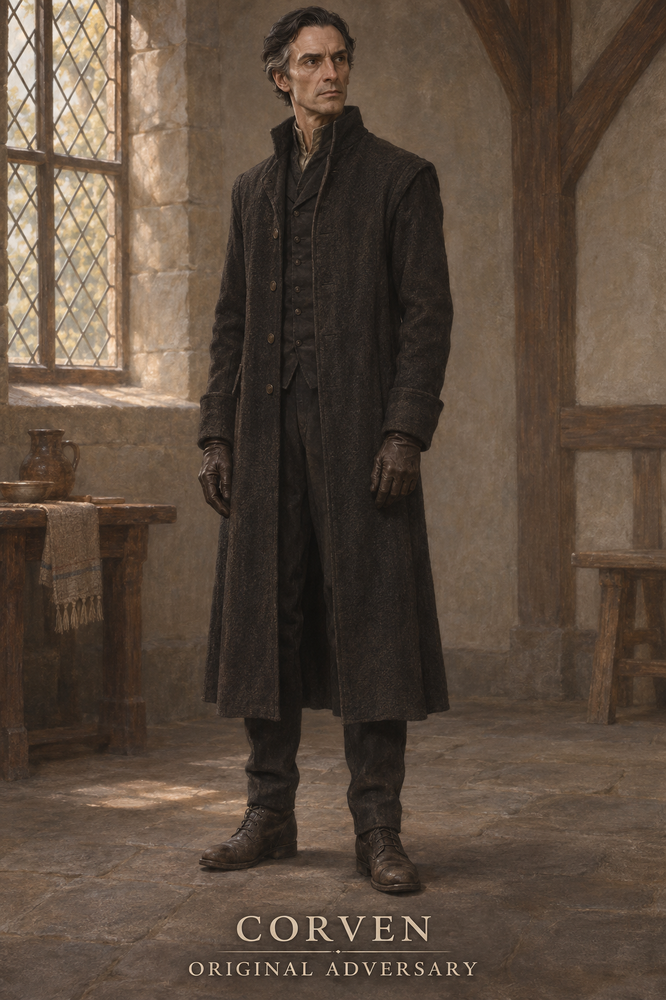

# Corven

Adversary at large in last verified Day 44 record; no later defeat/capture established.

## Update — Year 848 Suncrest 4 Day 124, 01:45

A lodge supervisor also named Corven surrendered at North Return House. Identity with this older adversary is not established by the supplied handoff. See separate `corven-north-return-house` record; this historical adversary’s disposition remains unverified.


## Player-approved character reference design

Approved from the supplied character-sheet draft in [character-reference-design-approval](../../changes/chronicles/character-reference-design-approval.md). The appearance, clothing and mannerisms below are new reference design approved for repository use, not recovered historical observations. They do not establish a sighting, whereabouts, inventory acquisition, guilt, abilities, kinship or past action. Reference ages are design values, not a calendar advance; exact measurements not supplied below remain unspecified.

- **Recorded role and continuity:** Unresolved earlier adversary; last verified at large in Day44 record. Malrec/Corven thread remains unresolved for this individual.
- **Sex, ancestry, age, measurements and appearance:** Human male, 50; 5 ft 11 in, 170 lb. Thin upright build, cool beige skin, narrow face, deep-set brown eyes. Dark hair graying above ears; clean-shaven.
- **Clothing and image-reference equipment:** Restrained charcoal clothing, high-collared wool coat, worn gloves; no confirmed faction emblem.
- **Personality, mannerisms and speech:** Controlled, watchful, spare expression. Turns whole head toward speaker; allows silence before replying.
- **Historical gaps and boundaries:** Later whereabouts, exact activities and identity relative to North Return House Corven. Visual distinction does not resolve identity.


## Character portrait



[Portrait gallery](../../artwork/character-references/README.md) · [Approved design provenance](../../changes/chronicles/character-reference-design-approval.md). Generated from the approved reference description; incidental visual details and background are artistic interpretation, not additional played facts.


## Character sheet

```yaml
character_sheet:
  id: corven
  name: Corven
  aliases: null
  ancestry: null
  sex: null
  age: null
  role: Earlier conspiracy adversary
  rank: null
  level: null
  hp: null
  hp_max: null
  mp: null
  mp_max: null
  defense: null
  equipped_defense: null
  str: null
  dex: null
  con: null
  int: null
  wis: null
  cha: null
  unspent_attributes: null
  skills: null
  abilities: null
  equipment: null
  mount: null
  personal_cash: null
  relationships: null
  assessment: null
  recorded_context: Adversary at large in last verified Day 44 record; no later defeat/capture established.
  approved_portrait_reference:
    appearance: Human male, 50; 5 ft 11 in, 170 lb. Thin upright build, cool beige skin, narrow face,
      deep-set brown eyes. Dark hair graying above ears; clean-shaven.
    clothing: Restrained charcoal clothing, high-collared wool coat, worn gloves; no confirmed faction
      emblem.
    personality: Controlled, watchful, spare expression. Turns whole head toward speaker; allows silence
      before replying.
    gaps: Later whereabouts, exact activities and identity relative to North Return House Corven. Visual
      distinction does not resolve identity.
    artwork_ref: artwork/character-references/corven.png
  source_refs:
  - entities/characters/corven.md
  - changes/chronicles/character-reference-design-approval.md
```
