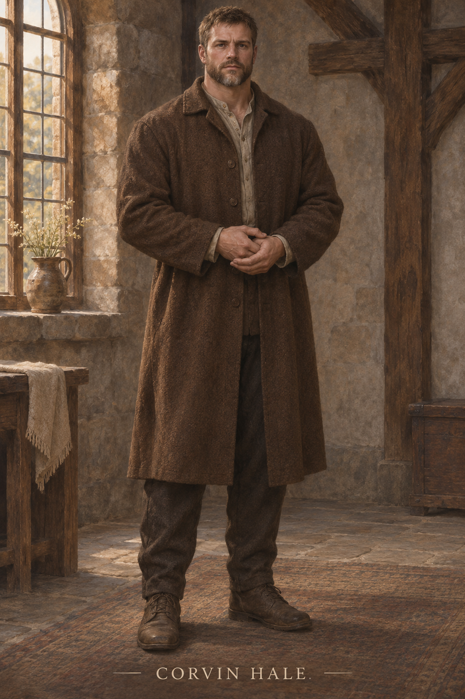

# Corvin Hale

Alive, detained at fortified wagon camp. No transfer or release. Do not conflate with Corvin Halbrecht or Corven.


## Player-approved character reference design

Approved from the supplied character-sheet draft in [character-reference-design-approval](../../changes/chronicles/character-reference-design-approval.md). The appearance, clothing and mannerisms below are new reference design approved for repository use, not recovered historical observations. They do not establish a sighting, whereabouts, inventory acquisition, guilt, abilities, kinship or past action. Reference ages are design values, not a calendar advance; exact measurements not supplied below remain unspecified.

- **Recorded role and continuity:** Alive and detained at fortified wagon camp on Year847 Day472. Distinct from Corvin Halbrecht and Corven.
- **Sex, ancestry, age, measurements and appearance:** Human male, 39; 6 ft 1 in, 205 lb. Broad heavy shoulders, fair skin, square jaw, pale brown eyes. Short dark blond hair; close beard with early gray chin patch.
- **Clothing and image-reference equipment:** Plain brown wool coat, dark trousers, serviceable boots; no unverified insignia.
- **Personality, mannerisms and speech:** Reserved, physically controlled. Rubs heel of hand with thumb; short sentences and direct attention to questioner.
- **Historical gaps and boundaries:** Background, affiliation, detention grounds and later outcome.


## Character portrait



[Portrait gallery](../../artwork/character-references/README.md) · [Approved design provenance](../../changes/chronicles/character-reference-design-approval.md). Generated from the approved reference description; incidental visual details and background are artistic interpretation, not additional played facts.


## Character sheet

```yaml
character_sheet:
  id: corvin-hale
  name: Corvin Hale
  aliases: null
  ancestry: null
  sex: null
  age: null
  role: Documented detainee at last verified observation
  rank: null
  level: null
  hp: null
  hp_max: null
  mp: null
  mp_max: null
  defense: null
  equipped_defense: null
  str: null
  dex: null
  con: null
  int: null
  wis: null
  cha: null
  unspent_attributes: null
  skills: null
  abilities: null
  equipment: null
  mount: null
  personal_cash: null
  relationships: null
  assessment: null
  recorded_context: Alive, detained at fortified wagon camp. No transfer or release. Do not conflate with
    Corvin Halbrecht or Corven.
  approved_portrait_reference:
    appearance: Human male, 39; 6 ft 1 in, 205 lb. Broad heavy shoulders, fair skin, square jaw, pale
      brown eyes. Short dark blond hair; close beard with early gray chin patch.
    clothing: Plain brown wool coat, dark trousers, serviceable boots; no unverified insignia.
    personality: Reserved, physically controlled. Rubs heel of hand with thumb; short sentences and direct
      attention to questioner.
    gaps: Background, affiliation, detention grounds and later outcome.
    artwork_ref: artwork/character-references/corvin-hale.png
  source_refs:
  - entities/characters/corvin-hale.md
  - changes/chronicles/character-reference-design-approval.md
```
