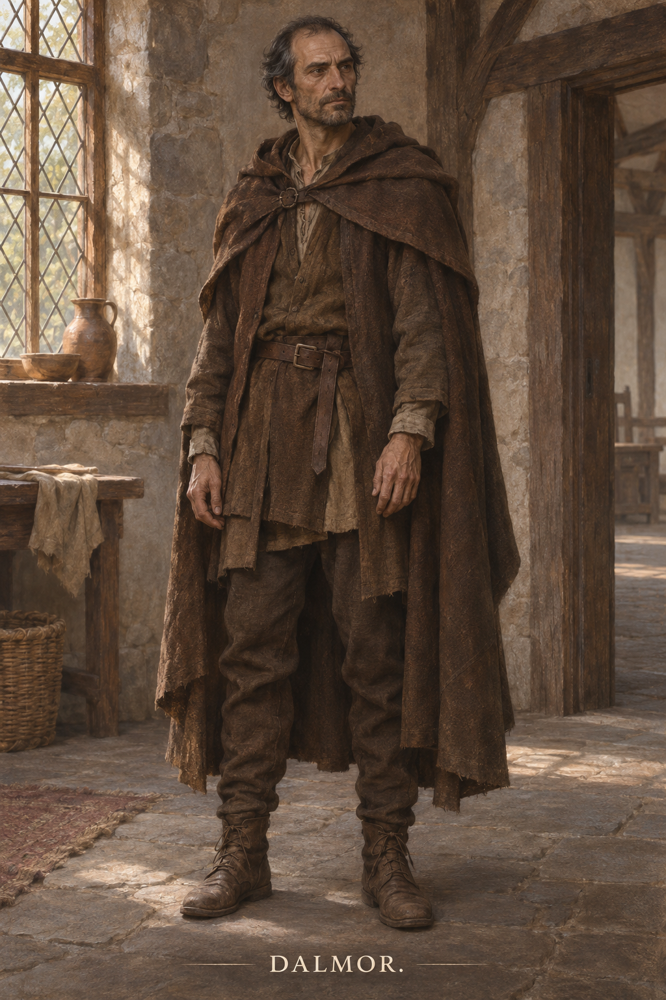

# Dalmor

Survived an earlier conspiracy confrontation; historical registry records alive. Later circumstances unknown.


## Player-approved character reference design

Approved from the supplied character-sheet draft in [character-reference-design-approval](../../changes/chronicles/character-reference-design-approval.md). The appearance, clothing and mannerisms below are new reference design approved for repository use, not recovered historical observations. They do not establish a sighting, whereabouts, inventory acquisition, guilt, abilities, kinship or past action. Reference ages are design values, not a calendar advance; exact measurements not supplied below remain unspecified.

- **Recorded role and continuity:** Survived an earlier conspiracy confrontation; historical registry records alive. Later circumstances unknown.
- **Sex, ancestry, age, measurements and appearance:** Human male, 48; 6 ft 0 in, 185 lb. Lean weathered build, strong shoulders. Sallow olive skin, angular face, dark hazel eyes; thinning black hair streaked gray, short rough beard.
- **Clothing and image-reference equipment:** Plain travel-worn brown layers, weatherproof cloak; no unverified affiliation insignia.
- **Personality, mannerisms and speech:** Guarded, deliberate, hard to read. Studies exits, pauses before answers, keeps hands visible in tense conversations.
- **Historical gaps and boundaries:** Actual role, loyalties, resources, whereabouts and earlier confrontation details. Caution is not evidence of guilt.


## Character portrait



[Portrait gallery](../../artwork/character-references/README.md) · [Approved design provenance](../../changes/chronicles/character-reference-design-approval.md). Generated from the approved reference description; incidental visual details and background are artistic interpretation, not additional played facts.


## Character sheet

```yaml
character_sheet:
  id: dalmor
  name: Dalmor
  aliases: null
  ancestry: null
  sex: null
  age: null
  role: null
  rank: null
  level: null
  hp: null
  hp_max: null
  mp: null
  mp_max: null
  defense: null
  equipped_defense: null
  str: null
  dex: null
  con: null
  int: null
  wis: null
  cha: null
  unspent_attributes: null
  skills: null
  abilities: null
  equipment: null
  mount: null
  personal_cash: null
  relationships: null
  assessment: null
  recorded_context: Survived an earlier conspiracy confrontation; historical registry records alive. Later
    circumstances unknown.
  approved_portrait_reference:
    appearance: Human male, 48; 6 ft 0 in, 185 lb. Lean weathered build, strong shoulders. Sallow olive
      skin, angular face, dark hazel eyes; thinning black hair streaked gray, short rough beard.
    clothing: Plain travel-worn brown layers, weatherproof cloak; no unverified affiliation insignia.
    personality: Guarded, deliberate, hard to read. Studies exits, pauses before answers, keeps hands
      visible in tense conversations.
    gaps: Actual role, loyalties, resources, whereabouts and earlier confrontation details. Caution is
      not evidence of guilt.
    artwork_ref: artwork/character-references/dalmor.png
  source_refs:
  - entities/characters/dalmor.md
  - changes/chronicles/character-reference-design-approval.md
  character_design_profile:
    classification: Prospective character design; use recorded facts wherever they exist
    apparent_age_for_art: '43'
    presentation_for_art: masculine-presenting
    visual_ancestry_or_form: humanoid
    appearance: Human male, 48; 6 ft 0 in, 185 lb. Lean weathered build, strong shoulders. Sallow olive skin,
      angular face, dark hazel eyes; thinning black hair streaked gray, short rough beard.
    wardrobe_and_props: Plain travel-worn brown layers, weatherproof cloak; no unverified affiliation insignia.
    character_motivation: Wants to choose when and where to speak.
    practice_and_professional_skills:
    - cautious negotiation
    - situational observation
    magic_and_healing: Ordinary nonmagical design. No personal spellcasting assigned.
    abilities_and_techniques:
    - 'Cautious negotiation: practical proficiency for roleplay and assessment.'
    unassessed_stat_proposal:
      hp_max: 18
      base_defense: 8
      str: 9
      dex: 10
      con: 10
      int: 10
      wis: 10
      cha: 10
      mp_max: 0
    portrait_reference: artwork/character-references/dalmor.png
  image_generator_prompt: 'Full-body medieval high fantasy character portrait of Dalmor, masculine-presenting,
    humanoid. Age presentation: 43. Appearance: Human male, 48; 6 ft 0 in, 185 lb. Lean weathered build, strong
    shoulders. Sallow olive skin, angular face, dark hazel eyes; thinning black hair streaked gray, short rough
    beard. Clothing and posed props: Plain travel-worn brown layers, weatherproof cloak; no unverified affiliation
    insignia. Match the established face, build, colors and costume in artwork/character-references/dalmor.png
    if supplied as a reference image. Three-quarter stance, unobstructed face and hands, even natural light,
    muted neutral backdrop, realistic fabric and material texture. Props are illustrative. No lettering, extra
    people, active spell effects, hidden symbols, or scene-specific location clues.'
```
