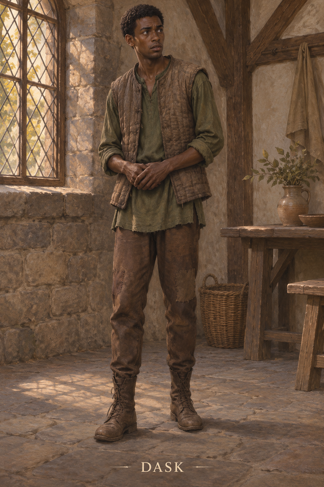

# Dask

Rear guard at North Return House; cooperatively surrendered and secured unharmed. One of three current expedition detainees, guarded nonlethally by Garrick; no transfer or punishment.


## Player-approved character reference design

Approved from the supplied character-sheet draft in [character-reference-design-approval](../../changes/chronicles/character-reference-design-approval.md). The appearance, clothing and mannerisms below are new reference design approved for repository use, not recovered historical observations. They do not establish a sighting, whereabouts, inventory acquisition, guilt, abilities, kinship or past action. Reference ages are design values, not a calendar advance; exact measurements not supplied below remain unspecified.

- **Recorded role and continuity:** North Return House rear guard; cooperatively surrendered unharmed. Nonlethal Garrick custody at Day124.
- **Sex, ancestry, age, measurements and appearance:** Human male, 25; 6 ft 2 in, 175 lb. Tall lean build, slightly rounded shoulders. Dark brown skin, dark eyes; short tightly curled black hair, clean-shaven.
- **Clothing and image-reference equipment:** Faded green tunic, ill-fitting padded vest, patched trousers, practical boots.
- **Personality, mannerisms and speech:** Alert, cautious, visibly nervous. Swallows before speech, grips objects tightly, looks quickly toward sudden sounds.
- **Historical gaps and boundaries:** Background, employer details, testimony, culpability and later disposition.


## Character portrait



[Portrait gallery](../../artwork/character-references/README.md) · [Approved design provenance](../../changes/chronicles/character-reference-design-approval.md). Generated from the approved reference description; incidental visual details and background are artistic interpretation, not additional played facts.


## Character sheet

```yaml
character_sheet:
  id: dask
  name: Dask
  aliases: null
  ancestry: null
  sex: null
  age: null
  role: North Return House rear guard
  rank: null
  level: null
  hp: null
  hp_max: null
  mp: null
  mp_max: null
  defense: null
  equipped_defense: null
  str: null
  dex: null
  con: null
  int: null
  wis: null
  cha: null
  unspent_attributes: null
  skills: null
  abilities: null
  equipment: null
  mount: null
  personal_cash: null
  relationships: null
  assessment: null
  recorded_context: Rear guard at North Return House; cooperatively surrendered and secured unharmed.
    One of three current expedition detainees, guarded nonlethally by Garrick; no transfer or punishment.
  approved_portrait_reference:
    appearance: Human male, 25; 6 ft 2 in, 175 lb. Tall lean build, slightly rounded shoulders. Dark brown
      skin, dark eyes; short tightly curled black hair, clean-shaven.
    clothing: Faded green tunic, ill-fitting padded vest, patched trousers, practical boots.
    personality: Alert, cautious, visibly nervous. Swallows before speech, grips objects tightly, looks
      quickly toward sudden sounds.
    gaps: Background, employer details, testimony, culpability and later disposition.
    artwork_ref: artwork/character-references/dask.png
  source_refs:
  - entities/characters/dask.md
  - changes/chronicles/character-reference-design-approval.md
  character_design_profile:
    classification: Prospective character design; use recorded facts wherever they exist
    apparent_age_for_art: '34'
    presentation_for_art: masculine-presenting
    visual_ancestry_or_form: humanoid
    appearance: Human male, 25; 6 ft 2 in, 175 lb. Tall lean build, slightly rounded shoulders. Dark brown skin,
      dark eyes; short tightly curled black hair, clean-shaven.
    wardrobe_and_props: Faded green tunic, ill-fitting padded vest, patched trousers, practical boots.
    character_motivation: Wants to be judged for his own actions.
    practice_and_professional_skills:
    - rear-guard positioning
    - team signals
    magic_and_healing: Ordinary nonmagical design. No personal spellcasting assigned.
    abilities_and_techniques:
    - 'Rear-guard positioning: practical proficiency for roleplay and assessment.'
    unassessed_stat_proposal:
      hp_max: 28
      base_defense: 12
      str: 12
      dex: 13
      con: 12
      int: 10
      wis: 11
      cha: 10
      mp_max: 0
    portrait_reference: artwork/character-references/dask.png
  image_generator_prompt: 'Full-body medieval high fantasy character portrait of Dask, masculine-presenting,
    humanoid. Age presentation: 34. Appearance: Human male, 25; 6 ft 2 in, 175 lb. Tall lean build, slightly
    rounded shoulders. Dark brown skin, dark eyes; short tightly curled black hair, clean-shaven. Clothing and
    posed props: Faded green tunic, ill-fitting padded vest, patched trousers, practical boots. Match the established
    face, build, colors and costume in artwork/character-references/dask.png if supplied as a reference image.
    Three-quarter stance, unobstructed face and hands, even natural light, muted neutral backdrop, realistic
    fabric and material texture. Props are illustrative. No lettering, extra people, active spell effects, hidden
    symbols, or scene-specific location clues.'
```
