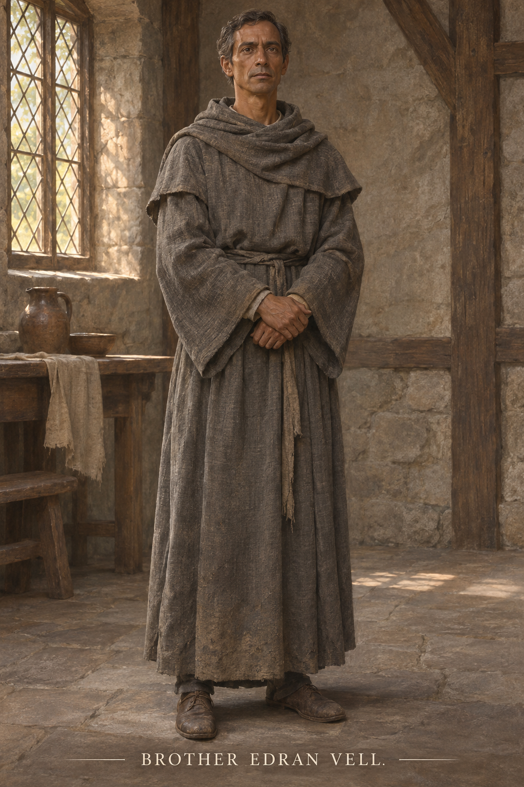

# Brother Edran Vell

Alive, detained at fortified wagon camp. No transfer or release.


## Player-approved character reference design

Approved from the supplied character-sheet draft in [character-reference-design-approval](../../changes/chronicles/character-reference-design-approval.md). The appearance, clothing and mannerisms below are new reference design approved for repository use, not recovered historical observations. They do not establish a sighting, whereabouts, inventory acquisition, guilt, abilities, kinship or past action. Reference ages are design values, not a calendar advance; exact measurements not supplied below remain unspecified.

- **Recorded role and continuity:** Alive and detained at fortified wagon camp on Year847 Day472; camp custody reinforced by two previously paid contracted guards.
- **Sex, ancestry, age, measurements and appearance:** Human male, 46; 5 ft 10 in, 175 lb. Average build, narrow face, medium brown skin, gray eyes. Short graying brown hair, clean-shaven.
- **Clothing and image-reference equipment:** Plain travel-worn gray robe, simple shoes; no invented religious emblem or order insignia.
- **Personality, mannerisms and speech:** Formal, restrained. Folds hands, chooses words carefully, measured speaking rhythm under pressure.
- **Historical gaps and boundaries:** Meaning of Brother, affiliation, detention grounds, testimony and later disposition.


## Character portrait



[Portrait gallery](../../artwork/character-references/README.md) · [Approved design provenance](../../changes/chronicles/character-reference-design-approval.md). Generated from the approved reference description; incidental visual details and background are artistic interpretation, not additional played facts.


## Character sheet

```yaml
character_sheet:
  id: edran-vell
  name: Brother Edran Vell
  aliases: null
  ancestry: null
  sex: null
  age: null
  role: Documented detainee at last verified observation
  rank: null
  level: null
  hp: null
  hp_max: null
  mp: null
  mp_max: null
  defense: null
  equipped_defense: null
  str: null
  dex: null
  con: null
  int: null
  wis: null
  cha: null
  unspent_attributes: null
  skills: null
  abilities: null
  equipment: null
  mount: null
  personal_cash: null
  relationships: null
  assessment: null
  recorded_context: Alive, detained at fortified wagon camp. No transfer or release.
  approved_portrait_reference:
    appearance: Human male, 46; 5 ft 10 in, 175 lb. Average build, narrow face, medium brown skin, gray
      eyes. Short graying brown hair, clean-shaven.
    clothing: Plain travel-worn gray robe, simple shoes; no invented religious emblem or order insignia.
    personality: Formal, restrained. Folds hands, chooses words carefully, measured speaking rhythm under
      pressure.
    gaps: Meaning of Brother, affiliation, detention grounds, testimony and later disposition.
    artwork_ref: artwork/character-references/edran-vell.png
  source_refs:
  - entities/characters/edran-vell.md
  - changes/chronicles/character-reference-design-approval.md
  character_design_profile:
    classification: Prospective character design; use recorded facts wherever they exist
    apparent_age_for_art: '40'
    presentation_for_art: masculine-presenting
    visual_ancestry_or_form: humanoid
    appearance: Human male, 46; 5 ft 10 in, 175 lb. Average build, narrow face, medium brown skin, gray eyes.
      Short graying brown hair, clean-shaven.
    wardrobe_and_props: Plain travel-worn gray robe, simple shoes; no invented religious emblem or order insignia.
    character_motivation: Wants to give an accurate account in his own words.
    practice_and_professional_skills:
    - careful recollection
    - formal address
    magic_and_healing: Ordinary nonmagical design. No personal spellcasting assigned.
    abilities_and_techniques:
    - 'Careful recollection: practical proficiency for roleplay and assessment.'
    unassessed_stat_proposal:
      hp_max: 18
      base_defense: 8
      str: 9
      dex: 10
      con: 10
      int: 10
      wis: 10
      cha: 10
      mp_max: 0
    portrait_reference: artwork/character-references/edran-vell.png
  image_generator_prompt: 'Full-body medieval high fantasy character portrait of Brother Edran Vell, masculine-presenting,
    humanoid. Age presentation: 40. Appearance: Human male, 46; 5 ft 10 in, 175 lb. Average build, narrow face,
    medium brown skin, gray eyes. Short graying brown hair, clean-shaven. Clothing and posed props: Plain travel-worn
    gray robe, simple shoes; no invented religious emblem or order insignia. Match the established face, build,
    colors and costume in artwork/character-references/edran-vell.png if supplied as a reference image. Three-quarter
    stance, unobstructed face and hands, even natural light, muted neutral backdrop, realistic fabric and material
    texture. Props are illustrative. No lettering, extra people, active spell effects, hidden symbols, or scene-specific
    location clues.'
```
