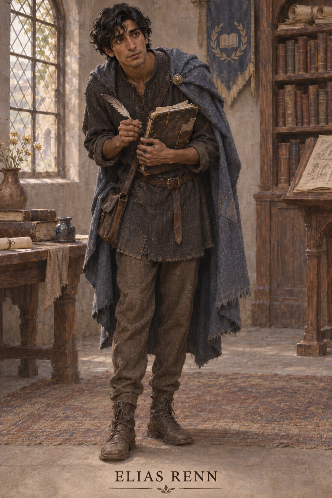

# Elias Renn

Adult participant in the Greyhaven Valley academy pilot day school. No additional biography or powers established.

## Player-approved character reference design

Approved from the supplied character-sheet draft in [character-reference-design-approval](../../changes/chronicles/character-reference-design-approval.md). The appearance, clothing and mannerisms below are new reference design approved for repository use, not recovered historical observations. They do not establish a sighting, whereabouts, inventory acquisition, guilt, abilities, kinship or past action. Reference ages are design values, not a calendar advance; exact measurements not supplied below remain unspecified.

- **Recorded role and continuity:** Adult participant in the Greyhaven Valley academy pilot day school.
- **Sex, ancestry, age, measurements and appearance:** Human male, 29; 5 ft 11 in, 165 lb. Lean, narrow shoulders, long fingers. Warm brown skin, long face, dark brown eyes; wavy black hair falling over forehead. Clean-shaven.
- **Clothing and image-reference equipment:** Carefully mended charcoal tunic, plain trousers, secondhand blue-gray cloak. Ink-stained fingers and battered notebook.
- **Personality, mannerisms and speech:** Earnest, observant, slightly self-conscious about adult learning. Leans forward during explanations, writes margin questions, rehearses unfamiliar terms under his breath.
- **Historical gaps and boundaries:** Previous occupation, magical aptitude and reason for joining.

## Character portrait

[Portrait gallery](../../artwork/character-references/README.md) · [Approved design provenance](../../changes/chronicles/character-reference-design-approval.md). Generated from the approved reference description; incidental visual details and background are artistic interpretation, not additional played facts.
