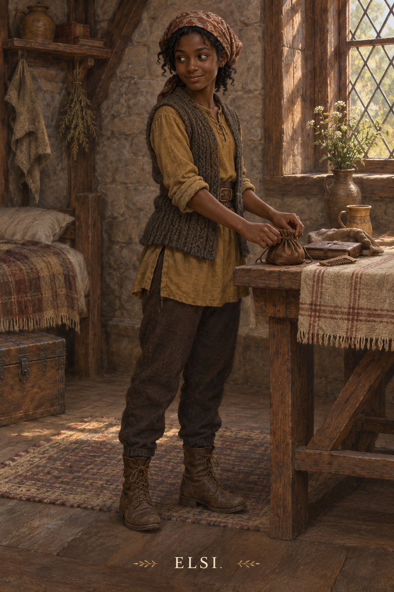

# Elsi

Recorded age 14; Briarfall children's home; optional supervised safe light paid lodge work.


## Player-approved character reference design

Approved from the supplied character-sheet draft in [character-reference-design-approval](../../changes/chronicles/character-reference-design-approval.md). The appearance, clothing and mannerisms below are new reference design approved for repository use, not recovered historical observations. They do not establish a sighting, whereabouts, inventory acquisition, guilt, abilities, kinship or past action. Reference ages are design values, not a calendar advance; exact measurements not supplied below remain unspecified.

- **Recorded role and continuity:** Recorded age 14; Briarfall children's home; optional supervised safe light paid lodge work.
- **Sex, ancestry, age, measurements and appearance:** Human girl; approximately 4 ft 11 in, small sturdy build. Deep brown skin, dark eyes; tightly curled black hair under patterned kerchief.
- **Clothing and image-reference equipment:** Ochre tunic, dark skirt or trousers, knitted vest, practical boots.
- **Personality, mannerisms and speech:** Quietly funny, observant, cautious with unfamiliar adults. Watches hands and expressions, arranges belongings neatly; sideways smile before dry remarks.
- **Historical gaps and boundaries:** Surname, family history, individual duties and interests. Recorded age is not automatically advanced.

Shelter, meals and schooling remain unconditional. Work is optional, supervised, safe, light and paid; no hazardous, forge or night work. Reference clothing does not assign a new job.


## Character portrait



[Portrait gallery](../../artwork/character-references/README.md) · [Approved design provenance](../../changes/chronicles/character-reference-design-approval.md). Generated from the approved reference description; incidental visual details and background are artistic interpretation, not additional played facts.


## Character sheet

```yaml
character_sheet:
  id: elsi
  name: Elsi
  aliases: null
  ancestry: null
  sex: null
  age: 14
  role: Briarfall children’s home resident; optional supervised light lodge work
  rank: null
  level: null
  hp: null
  hp_max: null
  mp: null
  mp_max: null
  defense: null
  equipped_defense: null
  str: null
  dex: null
  con: null
  int: null
  wis: null
  cha: null
  unspent_attributes: null
  skills: null
  abilities: null
  equipment: null
  mount: null
  personal_cash: null
  relationships: null
  assessment: null
  recorded_context: Recorded age 14; Briarfall children's home; optional supervised safe light paid lodge
    work.
  approved_portrait_reference:
    appearance: Human girl; approximately 4 ft 11 in, small sturdy build. Deep brown skin, dark eyes;
      tightly curled black hair under patterned kerchief.
    clothing: Ochre tunic, dark skirt or trousers, knitted vest, practical boots.
    personality: Quietly funny, observant, cautious with unfamiliar adults. Watches hands and expressions,
      arranges belongings neatly; sideways smile before dry remarks.
    gaps: Surname, family history, individual duties and interests. Recorded age is not automatically
      advanced.
    artwork_ref: artwork/character-references/elsi.png
  source_refs:
  - entities/characters/elsi.md
  - changes/chronicles/character-reference-design-approval.md
  character_design_profile:
    classification: Prospective character design; use recorded facts wherever they exist
    apparent_age_for_art: 14
    presentation_for_art: feminine-presenting
    visual_ancestry_or_form: humanoid
    appearance: Human girl; approximately 4 ft 11 in, small sturdy build. Deep brown skin, dark eyes; tightly
      curled black hair under patterned kerchief.
    wardrobe_and_props: Ochre tunic, dark skirt or trousers, knitted vest, practical boots.
    character_motivation: Wants to choose which work and interests to pursue.
    practice_and_professional_skills:
    - supervised lodge chores
    - household organization
    magic_and_healing: Ordinary nonmagical design. No personal spellcasting assigned.
    abilities_and_techniques:
    - 'Supervised lodge chores: practical proficiency for roleplay and assessment.'
    unassessed_stat_proposal:
      hp_max: 18
      base_defense: 8
      str: 9
      dex: 10
      con: 10
      int: 10
      wis: 10
      cha: 10
      mp_max: 0
    portrait_reference: artwork/character-references/elsi.png
  image_generator_prompt: 'Full-body medieval high fantasy character portrait of Elsi, feminine-presenting,
    humanoid. Version shown at apparent age 14. Appearance: Human girl; approximately 4 ft 11 in, small sturdy
    build. Deep brown skin, dark eyes; tightly curled black hair under patterned kerchief. Clothing and posed
    props: Ochre tunic, dark skirt or trousers, knitted vest, practical boots. Match the established face, build,
    colors and costume in artwork/character-references/elsi.png if supplied as a reference image. Three-quarter
    stance, unobstructed face and hands, even natural light, muted neutral backdrop, realistic fabric and material
    texture. Props are illustrative. No lettering, extra people, active spell effects, hidden symbols, or scene-specific
    location clues.'
```
