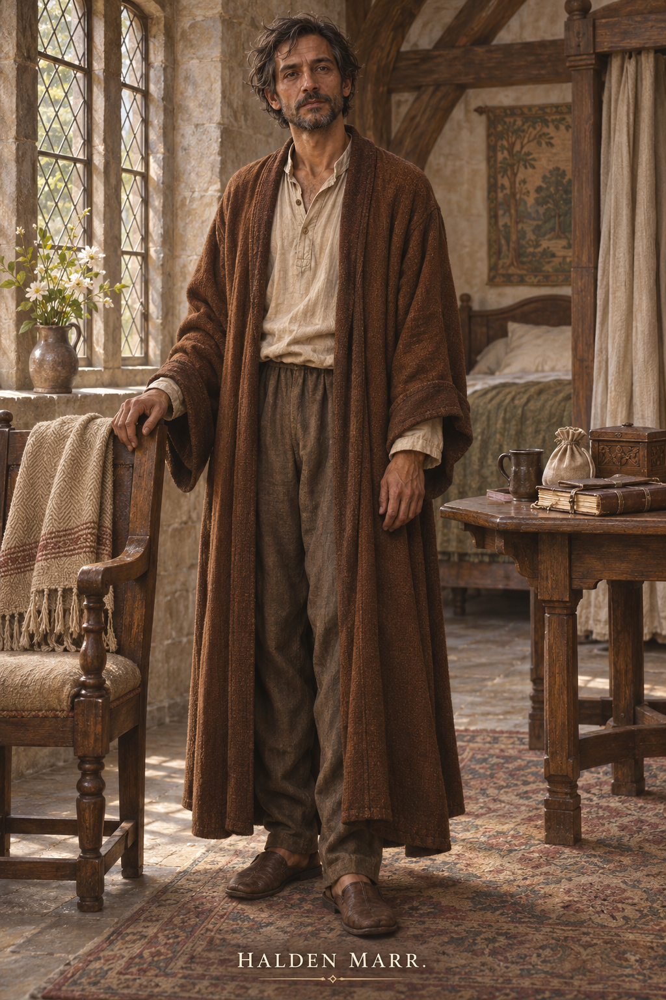

# Halden Marr

Identification plate and probable notes recovered at Northern Depository; later rescued. By Year848 Day137 free and voluntarily protected at Ashvale Estate, receiving Lyra's care.


## Player-approved character reference design

Approved from the supplied character-sheet draft in [character-reference-design-approval](../../changes/chronicles/character-reference-design-approval.md). The appearance, clothing and mannerisms below are new reference design approved for repository use, not recovered historical observations. They do not establish a sighting, whereabouts, inventory acquisition, guilt, abilities, kinship or past action. Reference ages are design values, not a calendar advance; exact measurements not supplied below remain unspecified.

- **Recorded role and continuity:** Identification plate and probable notes recovered at Northern Depository; later rescued. By Year848 Day137 free and voluntarily protected at Ashvale Estate, receiving Lyra's care.
- **Sex, ancestry, age, measurements and appearance:** Human male, 45; 5 ft 10 in, approximately 150 lb in recovery reference. Naturally lean frame, drawn features, medium brown skin, tired dark hazel eyes. Uneven dark brown hair with gray strands, short beard.
- **Clothing and image-reference equipment:** Clean loose linen shirt, soft trousers, warm brown robe or blanket. No restraints.
- **Personality, mannerisms and speech:** Observant, deliberate, room to regain confidence. Takes time before answers, appreciates direct address; keeps belongings within reach.
- **Historical gaps and boundaries:** Occupation, biography, diagnosis, testimony and rescue details. Probable notes are not authenticated authorship. Visual condition establishes no specific injury or psychological diagnosis.


## Character portrait



[Portrait gallery](../../artwork/character-references/README.md) · [Approved design provenance](../../changes/chronicles/character-reference-design-approval.md). Generated from the approved reference description; incidental visual details and background are artistic interpretation, not additional played facts.


## Character sheet

```yaml
character_sheet:
  id: halden-marr
  name: Halden Marr
  aliases: null
  ancestry: null
  sex: null
  age: null
  role: Rescued person under voluntary protection
  rank: null
  level: null
  hp: null
  hp_max: null
  mp: null
  mp_max: null
  defense: null
  equipped_defense: null
  str: null
  dex: null
  con: null
  int: null
  wis: null
  cha: null
  unspent_attributes: null
  skills: null
  abilities: null
  equipment: null
  mount: null
  personal_cash: null
  relationships: null
  assessment: null
  recorded_context: Rescued and voluntarily protected at Ashvale Estate under Lyra’s care, as recorded
    at Year 848 Day 137.
  approved_portrait_reference:
    appearance: Human male, 45; 5 ft 10 in, approximately 150 lb in recovery reference. Naturally lean
      frame, drawn features, medium brown skin, tired dark hazel eyes. Uneven dark brown hair with gray
      strands, short beard.
    clothing: Clean loose linen shirt, soft trousers, warm brown robe or blanket. No restraints.
    personality: Observant, deliberate, room to regain confidence. Takes time before answers, appreciates
      direct address; keeps belongings within reach.
    gaps: Occupation, biography, diagnosis, testimony and rescue details. Probable notes are not authenticated
      authorship. Visual condition establishes no specific injury or psychological diagnosis.
    artwork_ref: artwork/character-references/halden-marr.png
  source_refs:
  - entities/characters/halden-marr.md
  - changes/chronicles/character-reference-design-approval.md
  - entities/mechanics/independent-assignments.md
  - entities/locations/ashvale-estate.md
  last_reported_location: Ashvale Estate
  character_design_profile:
    classification: Prospective character design; use recorded facts wherever they exist
    apparent_age_for_art: '39'
    presentation_for_art: masculine-presenting
    visual_ancestry_or_form: humanoid
    appearance: Human male, 45; 5 ft 10 in, approximately 150 lb in recovery reference. Naturally lean frame,
      drawn features, medium brown skin, tired dark hazel eyes. Uneven dark brown hair with gray strands, short
      beard.
    wardrobe_and_props: Clean loose linen shirt, soft trousers, warm brown robe or blanket. No restraints.
    character_motivation: Wants privacy and choice during recovery.
    practice_and_professional_skills:
    - gradual recollection
    - asking for support
    magic_and_healing: Ordinary nonmagical design. No personal spellcasting assigned.
    abilities_and_techniques:
    - 'Gradual recollection: practical proficiency for roleplay and assessment.'
    unassessed_stat_proposal:
      hp_max: 18
      base_defense: 8
      str: 9
      dex: 10
      con: 10
      int: 10
      wis: 10
      cha: 10
      mp_max: 0
    portrait_reference: artwork/character-references/halden-marr.png
  image_generator_prompt: 'Full-body medieval high fantasy character portrait of Halden Marr, masculine-presenting,
    humanoid. Age presentation: 39. Appearance: Human male, 45; 5 ft 10 in, approximately 150 lb in recovery
    reference. Naturally lean frame, drawn features, medium brown skin, tired dark hazel eyes. Uneven dark brown
    hair with gray strands, short beard. Clothing and posed props: Clean loose linen shirt, soft trousers, warm
    brown robe or blanket. No restraints. Match the established face, build, colors and costume in artwork/character-references/halden-marr.png
    if supplied as a reference image. Three-quarter stance, unobstructed face and hands, even natural light,
    muted neutral backdrop, realistic fabric and material texture. Props are illustrative. No lettering, extra
    people, active spell effects, hidden symbols, or scene-specific location clues.'
```
