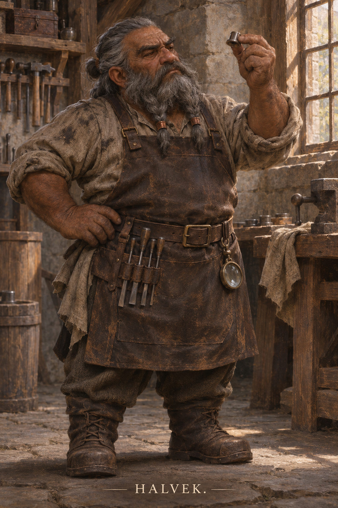

# Halvek

Runesmith whom Theron has an outstanding objective to seek.

## Player-approved character reference design

Approved from the supplied character-sheet draft in [character-reference-design-approval](../../changes/chronicles/character-reference-design-approval.md). The appearance, clothing and mannerisms below are new reference design approved for repository use, not recovered historical observations. They do not establish a sighting, whereabouts, inventory acquisition, guilt, abilities, kinship or past action. Reference ages are design values, not a calendar advance; exact measurements not supplied below remain unspecified.

- **Recorded role and continuity:** Runesmith whom Theron has an outstanding objective to seek.
- **Sex, ancestry, age, measurements and appearance:** Dwarf male, reference-design age 112; 4 ft 7 in, 190 lb. Broad dense build, powerful hands. Copper-brown skin, dark amber eyes, heavy brows. Iron-gray hair tied back; thick beard in two short working braids.
- **Clothing and image-reference equipment:** Soot-darkened linen, heavy leather apron, reinforced boots, simple copper beard clasps; fine chisels and magnifying lens.
- **Personality, mannerisms and speech:** Exacting, reserved, interested in function. Turns objects toward light before judging; taps material with fingernail while considering it.
- **Historical gaps and boundaries:** Historical species/age were unspecified; dwarf and 112 are approved design. Location, specialties, reputation and prior Theron contact remain unknown.

## Character portrait

[Portrait gallery](../../artwork/character-references/README.md) · [Approved design provenance](../../changes/chronicles/character-reference-design-approval.md). Generated from the approved reference description; incidental visual details and background are artistic interpretation, not additional played facts.
