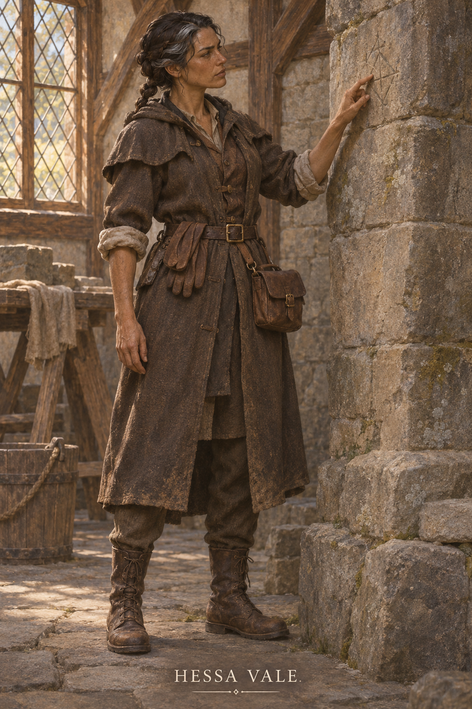

# Hessa Vale

Waykeeper repair worker; recognized discontinued sealed archive correspondence-circuit markings.


## Player-approved character reference design

Approved from the supplied character-sheet draft in [character-reference-design-approval](../../changes/chronicles/character-reference-design-approval.md). The appearance, clothing and mannerisms below are new reference design approved for repository use, not recovered historical observations. They do not establish a sighting, whereabouts, inventory acquisition, guilt, abilities, kinship or past action. Reference ages are design values, not a calendar advance; exact measurements not supplied below remain unspecified.

- **Recorded role and continuity:** Waykeeper repair worker; recognized discontinued sealed archive correspondence-circuit markings.
- **Sex, ancestry, age, measurements and appearance:** Human female, 41; 5 ft 8 in, 160 lb. Strong lean build, golden-brown skin, angular features, gray-green eyes. Dark brown short braid with silver near forehead.
- **Clothing and image-reference equipment:** Weatherproof work coat, rolled cuffs, leather gloves, compact repair satchel.
- **Personality, mannerisms and speech:** Technically curious, attentive to wear/workmanship. Crouches to examine markings, traces shapes in air, separates observation from guess.
- **Historical gaps and boundaries:** Rank, training, history and whereabouts. No kinship with Garrick or Serrik established.


## Character portrait



[Portrait gallery](../../artwork/character-references/README.md) · [Approved design provenance](../../changes/chronicles/character-reference-design-approval.md). Generated from the approved reference description; incidental visual details and background are artistic interpretation, not additional played facts.


## Character sheet

```yaml
character_sheet:
  id: hessa-vale
  name: Hessa Vale
  aliases: null
  ancestry: null
  sex: null
  age: null
  role: Waykeeper repair worker
  rank: null
  level: null
  hp: null
  hp_max: null
  mp: null
  mp_max: null
  defense: null
  equipped_defense: null
  str: null
  dex: null
  con: null
  int: null
  wis: null
  cha: null
  unspent_attributes: null
  skills:
  - Waykeeper repair work
  - Recognition of historical correspondence markings
  abilities: null
  equipment: null
  mount: null
  personal_cash: null
  relationships: null
  assessment: null
  recorded_context: Waykeeper repair worker; recognized discontinued sealed archive correspondence-circuit
    markings.
  approved_portrait_reference:
    appearance: Human female, 41; 5 ft 8 in, 160 lb. Strong lean build, golden-brown skin, angular features,
      gray-green eyes. Dark brown short braid with silver near forehead.
    clothing: Weatherproof work coat, rolled cuffs, leather gloves, compact repair satchel.
    personality: Technically curious, attentive to wear/workmanship. Crouches to examine markings, traces
      shapes in air, separates observation from guess.
    gaps: Rank, training, history and whereabouts. No kinship with Garrick or Serrik established.
    artwork_ref: artwork/character-references/hessa-vale.png
  source_refs:
  - entities/characters/hessa-vale.md
  - changes/chronicles/character-reference-design-approval.md
  character_design_profile:
    classification: Prospective character design; use recorded facts wherever they exist
    apparent_age_for_art: '33'
    presentation_for_art: feminine-presenting
    visual_ancestry_or_form: humanoid
    appearance: Human female, 41; 5 ft 8 in, 160 lb. Strong lean build, golden-brown skin, angular features,
      gray-green eyes. Dark brown short braid with silver near forehead.
    wardrobe_and_props: Weatherproof work coat, rolled cuffs, leather gloves, compact repair satchel.
    character_motivation: Wants obsolete markings documented before they disappear.
    practice_and_professional_skills:
    - Waykeeper repairs
    - recognition of old circuit markings
    magic_and_healing: Ordinary nonmagical design. No personal spellcasting assigned.
    abilities_and_techniques:
    - 'Waykeeper repairs: practical proficiency for roleplay and assessment.'
    unassessed_stat_proposal:
      hp_max: 24
      base_defense: 10
      str: 12
      dex: 11
      con: 12
      int: 12
      wis: 10
      cha: 10
      mp_max: 0
    portrait_reference: artwork/character-references/hessa-vale.png
  image_generator_prompt: 'Full-body medieval high fantasy character portrait of Hessa Vale, feminine-presenting,
    humanoid. Age presentation: 33. Appearance: Human female, 41; 5 ft 8 in, 160 lb. Strong lean build, golden-brown
    skin, angular features, gray-green eyes. Dark brown short braid with silver near forehead. Clothing and
    posed props: Weatherproof work coat, rolled cuffs, leather gloves, compact repair satchel. Match the established
    face, build, colors and costume in artwork/character-references/hessa-vale.png if supplied as a reference
    image. Three-quarter stance, unobstructed face and hands, even natural light, muted neutral backdrop, realistic
    fabric and material texture. Props are illustrative. No lettering, extra people, active spell effects, hidden
    symbols, or scene-specific location clues.'
```
