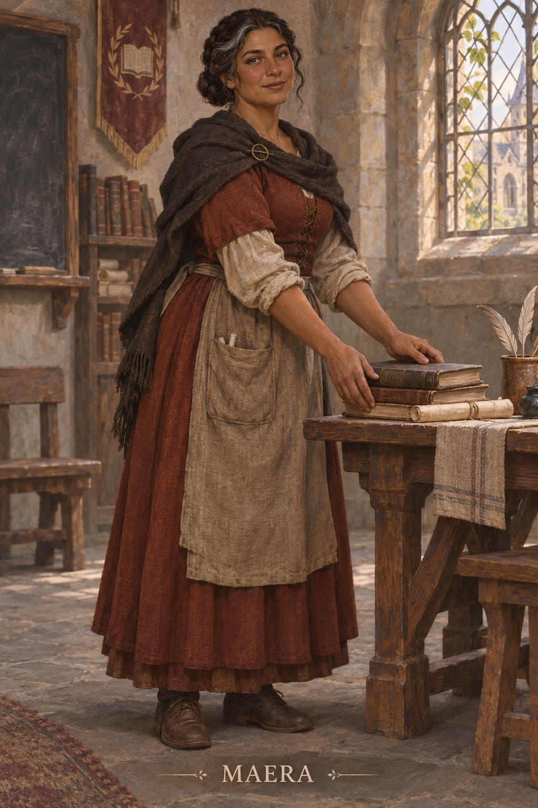

# Maera

Guardian of academy minor Mira Thorne; assists the pilot school. No surname or other relationship supplied.


## Player-approved character reference design

Approved from the supplied character-sheet draft in [character-reference-design-approval](../../changes/chronicles/character-reference-design-approval.md). The appearance, clothing and mannerisms below are new reference design approved for repository use, not recovered historical observations. They do not establish a sighting, whereabouts, inventory acquisition, guilt, abilities, kinship or past action. Reference ages are design values, not a calendar advance; exact measurements not supplied below remain unspecified.

- **Recorded role and continuity:** Guardian of Mira Thorne; assists academy pilot school.
- **Sex, ancestry, age, measurements and appearance:** Human female, 38; 5 ft 6 in, 165 lb. Solid, comfortably rounded build. Olive-brown skin, oval face, gray-green eyes. Dark brown hair in low braided bun, silver strands at temples.
- **Clothing and image-reference equipment:** Russet dress, cream sleeves, practical apron; dark shawl with plain bronze pin.
- **Personality, mannerisms and speech:** Warm, composed, protective without overbearing behavior. Straightens objects while thinking, meets children at eye level; becomes very still when a boundary is crossed.
- **Historical gaps and boundaries:** Surname, previous occupation and whether Mira's relative or another appointed guardian.


## Character portrait



[Portrait gallery](../../artwork/character-references/README.md) · [Approved design provenance](../../changes/chronicles/character-reference-design-approval.md). Generated from the approved reference description; incidental visual details and background are artistic interpretation, not additional played facts.


## Character sheet

```yaml
character_sheet:
  id: maera
  name: Maera
  aliases: null
  ancestry: null
  sex: null
  age: null
  role: Academy helper and guardian of Mira Thorne
  rank: null
  level: null
  hp: null
  hp_max: null
  mp: null
  mp_max: null
  defense: null
  equipped_defense: null
  str: null
  dex: null
  con: null
  int: null
  wis: null
  cha: null
  unspent_attributes: null
  skills: null
  abilities: null
  equipment: null
  mount: null
  personal_cash: null
  relationships:
    ward: mira-thorne
  assessment: null
  recorded_context: Guardian of academy minor Mira Thorne; assists the pilot school. No surname or other
    relationship supplied.
  approved_portrait_reference:
    appearance: Human female, 38; 5 ft 6 in, 165 lb. Solid, comfortably rounded build. Olive-brown skin,
      oval face, gray-green eyes. Dark brown hair in low braided bun, silver strands at temples.
    clothing: Russet dress, cream sleeves, practical apron; dark shawl with plain bronze pin.
    personality: Warm, composed, protective without overbearing behavior. Straightens objects while thinking,
      meets children at eye level; becomes very still when a boundary is crossed.
    gaps: Surname, previous occupation and whether Mira's relative or another appointed guardian.
    artwork_ref: artwork/character-references/maera.png
  source_refs:
  - entities/characters/maera.md
  - changes/chronicles/character-reference-design-approval.md
  - entities/factions/dragon-slayer-academy.md
```
