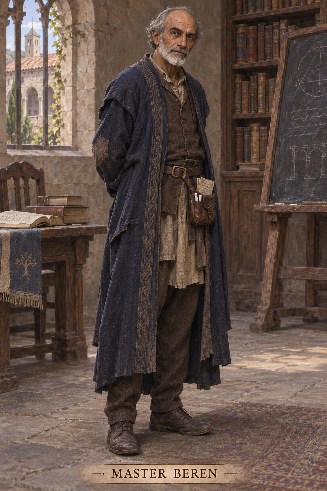

## Year 853 Day 145 reconciliation

Independent academy management. Day 129 corrected population 27. Three phased settlements remain separate from Theron’s funds.

## Earlier and standing records

# Master Beren

## Year 853 Day 52

Independent academy management in Greyhaven Valley, including recruitment, eligibility, finance, professional development and dormitory oversight.

Assists the Greyhaven Valley academy pilot. No additional role, lineage or powers supplied.

## Update — Year 848 Suncrest 4 Day 124, 01:45

Managing the independent Dragon Slayer Initiative Academy. No new financial report or completed assessment supplied.


## Player-approved character reference design

Approved from the supplied character-sheet draft in [character-reference-design-approval](../../changes/chronicles/character-reference-design-approval.md). The appearance, clothing and mannerisms below are new reference design approved for repository use, not recovered historical observations. They do not establish a sighting, whereabouts, inventory acquisition, guilt, abilities, kinship or past action. Reference ages are design values, not a calendar advance; exact measurements not supplied below remain unspecified.

- **Recorded role and continuity:** Assisted academy pilot; by Day124 manages independent Dragon Slayer Initiative Academy.
- **Sex, ancestry, age, measurements and appearance:** Human male, 61; 5 ft 8 in, 155 lb. Spare build, slightly stooped shoulders. Light brown skin, deep-set blue-gray eyes, prominent brows. Receding silver hair, high forehead; neatly trimmed white beard.
- **Clothing and image-reference equipment:** Faded navy scholar's robe over practical layers, patched elbows, sturdy shoes; chalk and notes pouch.
- **Personality, mannerisms and speech:** Deliberate, attentive, dry humor. Pauses before answering, folds hands behind back, explains with ordinary objects.
- **Historical gaps and boundaries:** Surname, qualifications, specialty, lineage and actual magical capabilities. Title establishes none of these.


## Character portrait



[Portrait gallery](../../artwork/character-references/README.md) · [Approved design provenance](../../changes/chronicles/character-reference-design-approval.md). Generated from the approved reference description; incidental visual details and background are artistic interpretation, not additional played facts.


## Year 853 session

Beren oversees the independent Greyhaven Valley academy, applies the prospective tithe, manages the funded expansion budget and supervises training and recruitment. He maintains the [progression registry](../mechanics/way-of-the-dragon.md) and oversees the [Buried Lantern Hall](../quests/buried-lantern-hall.md) investigation with Elias. Students remain excluded from restricted Watchpost areas.

## Character sheet

```yaml
character_sheet:
  id: master-beren
  name: Master Beren
  aliases: null
  ancestry: null
  sex: null
  age: null
  role: Independent DSI Academy manager
  rank: null
  level: null
  hp: null
  hp_max: null
  mp: null
  mp_max: null
  defense: null
  equipped_defense: null
  str: null
  dex: null
  con: null
  int: null
  wis: null
  cha: null
  unspent_attributes: null
  skills:
  - Academy administration
  - Recruitment and training oversight
  - Budget and construction oversight
  abilities: null
  equipment: null
  mount: null
  personal_cash: null
  relationships: null
  assessment: null
  recorded_context: Manages the independent DSI Academy. The earlier pilot-school helper role predates
    the management appointment.
  approved_portrait_reference:
    appearance: Human male, 61; 5 ft 8 in, 155 lb. Spare build, slightly stooped shoulders. Light brown
      skin, deep-set blue-gray eyes, prominent brows. Receding silver hair, high forehead; neatly trimmed
      white beard.
    clothing: Faded navy scholar's robe over practical layers, patched elbows, sturdy shoes; chalk and
      notes pouch.
    personality: Deliberate, attentive, dry humor. Pauses before answering, folds hands behind back, explains
      with ordinary objects.
    gaps: Surname, qualifications, specialty, lineage and actual magical capabilities. Title establishes
      none of these.
    artwork_ref: artwork/character-references/master-beren.png
  capability_evidence:
    mana_evidence: Academy management is established; personal casting and mana are unverified.
  source_refs:
  - changes/chronicles/year853-day145-reconciliation.md
  - entities/characters/master-beren.md
  - changes/chronicles/character-reference-design-approval.md
  - entities/mechanics/independent-assignments.md
  - entities/factions/dragon-slayer-academy.md
  character_design_profile:
    classification: Prospective character design; use recorded facts wherever they exist
    apparent_age_for_art: '59'
    presentation_for_art: masculine-presenting
    visual_ancestry_or_form: humanoid
    appearance: Human male, 61; 5 ft 8 in, 155 lb. Spare build, slightly stooped shoulders. Light brown skin,
      deep-set blue-gray eyes, prominent brows. Receding silver hair, high forehead; neatly trimmed white beard.
    wardrobe_and_props: Faded navy scholar's robe over practical layers, patched elbows, sturdy shoes; chalk
      and notes pouch.
    character_motivation: Wants a sustainable academy with responsible supervision.
    practice_and_professional_skills:
    - academy administration
    - training oversight
    magic_and_healing: Ordinary nonmagical design. No personal spellcasting assigned.
    abilities_and_techniques:
    - 'Academy administration: practical proficiency for roleplay and assessment.'
    unassessed_stat_proposal:
      hp_max: 24
      base_defense: 10
      str: 9
      dex: 10
      con: 11
      int: 13
      wis: 12
      cha: 14
      mp_max: 0
    portrait_reference: artwork/character-references/master-beren.png
  image_generator_prompt: 'Full-body medieval high fantasy character portrait of Master Beren, masculine-presenting,
    humanoid. Age presentation: 59. Appearance: Human male, 61; 5 ft 8 in, 155 lb. Spare build, slightly stooped
    shoulders. Light brown skin, deep-set blue-gray eyes, prominent brows. Receding silver hair, high forehead;
    neatly trimmed white beard. Clothing and posed props: Faded navy scholar''s robe over practical layers,
    patched elbows, sturdy shoes; chalk and notes pouch. Match the established face, build, colors and costume
    in artwork/character-references/master-beren.png if supplied as a reference image. Three-quarter stance,
    unobstructed face and hands, even natural light, muted neutral backdrop, realistic fabric and material texture.
    Props are illustrative. No lettering, extra people, active spell effects, hidden symbols, or scene-specific
    location clues.'
```
