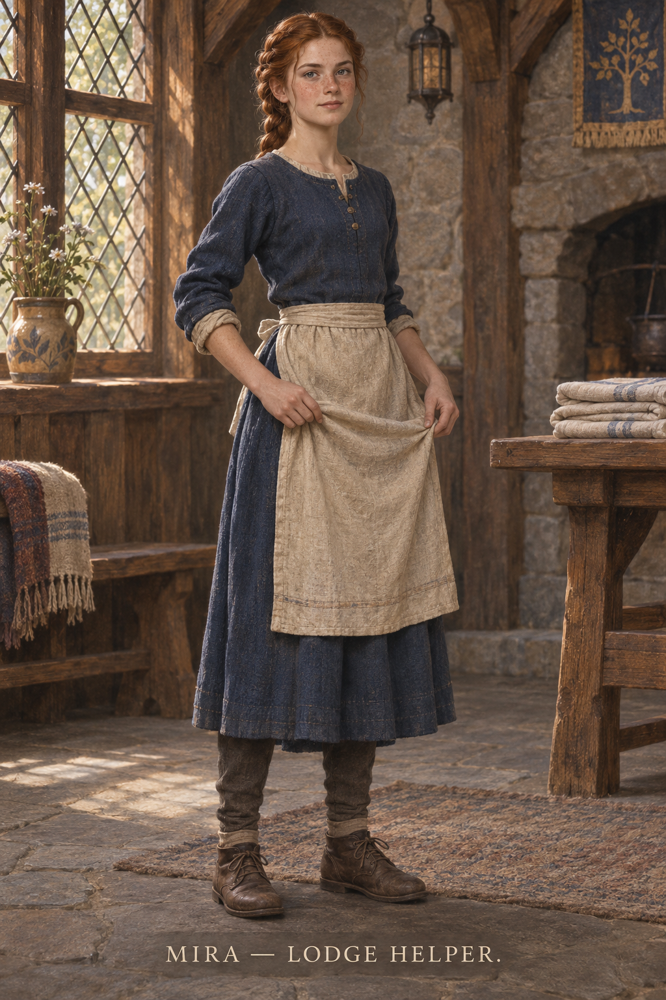

# Mira — lodge helper

Recorded age 15; Briarfall children's home. Optional supervised safe light paid lodge work. Distinct from Mira Thorne.


## Player-approved character reference design

Approved from the supplied character-sheet draft in [character-reference-design-approval](../../changes/chronicles/character-reference-design-approval.md). The appearance, clothing and mannerisms below are new reference design approved for repository use, not recovered historical observations. They do not establish a sighting, whereabouts, inventory acquisition, guilt, abilities, kinship or past action. Reference ages are design values, not a calendar advance; exact measurements not supplied below remain unspecified.

- **Recorded role and continuity:** Recorded age 15; Briarfall children's home. Optional supervised safe light paid lodge work. Distinct from Mira Thorne.
- **Sex, ancestry, age, measurements and appearance:** Human girl; approximately 5 ft 2 in, slight build. Freckled fair skin, gray-blue eyes; straight auburn hair securely braided back.
- **Clothing and image-reference equipment:** Simple blue dress or work tunic, leggings, clean apron, practical shoes.
- **Personality, mannerisms and speech:** Organized, direct, proud of reliability. Checks tasks twice, smooths apron when nervous; confident about familiar work.
- **Historical gaps and boundaries:** Surname, earlier family history, preferred vocation. Recorded age is not automatically advanced.

Shelter, meals and schooling remain unconditional. Work is optional, supervised, safe, light and paid; no hazardous, forge or night work. Reference clothing does not assign a new job.


## Character portrait



[Portrait gallery](../../artwork/character-references/README.md) · [Approved design provenance](../../changes/chronicles/character-reference-design-approval.md). Generated from the approved reference description; incidental visual details and background are artistic interpretation, not additional played facts.


## Character sheet

```yaml
character_sheet:
  id: mira-lodge-helper
  name: Mira — lodge helper
  aliases: null
  ancestry: null
  sex: null
  age: 15
  role: Briarfall children’s home resident; optional supervised light lodge work
  rank: null
  level: null
  hp: null
  hp_max: null
  mp: null
  mp_max: null
  defense: null
  equipped_defense: null
  str: null
  dex: null
  con: null
  int: null
  wis: null
  cha: null
  unspent_attributes: null
  skills: null
  abilities: null
  equipment: null
  mount: null
  personal_cash: null
  relationships: null
  assessment: null
  recorded_context: Recorded age 15; Briarfall children's home. Optional supervised safe light paid lodge
    work. Distinct from Mira Thorne.
  approved_portrait_reference:
    appearance: Human girl; approximately 5 ft 2 in, slight build. Freckled fair skin, gray-blue eyes;
      straight auburn hair securely braided back.
    clothing: Simple blue dress or work tunic, leggings, clean apron, practical shoes.
    personality: Organized, direct, proud of reliability. Checks tasks twice, smooths apron when nervous;
      confident about familiar work.
    gaps: Surname, earlier family history, preferred vocation. Recorded age is not automatically advanced.
    artwork_ref: artwork/character-references/mira-lodge-helper.png
  source_refs:
  - entities/characters/mira-lodge-helper.md
  - changes/chronicles/character-reference-design-approval.md
```
