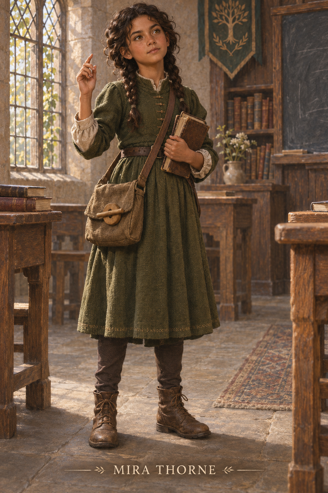

## Year 853 Day 145 reconciliation

Unregistered minor day student under Maera’s guardianship. Design reference age 12; exact historical age unknown. No Guild card, level, combat statistics, missions, earnings or Dragon Slayer initiation. The erroneous Day 69 entries are withdrawn.

## Earlier and standing records

## Year 848, Suncrest 262 update

DSI minor day student under Maera’s guardianship. No guild card or current eligibility for combat missions. Exact historical age and combat attributes remain unverified. Mira Thorne and the lodge helper are distinct, and no kinship with Nyx is established.

## Earlier record

# Mira Thorne

Minor academy day student; guardian Maera. Distinct from the lodge youth helper Mira, age15; do not merge identities or invent kinship with Nyx.


## Player-approved character reference design

Approved from the supplied character-sheet draft in [character-reference-design-approval](../../changes/chronicles/character-reference-design-approval.md). The appearance, clothing and mannerisms below are new reference design approved for repository use, not recovered historical observations. They do not establish a sighting, whereabouts, inventory acquisition, guilt, abilities, kinship or past action. Reference ages are design values, not a calendar advance; exact measurements not supplied below remain unspecified.

- **Recorded role and continuity:** Minor academy day student; guardian Maera. Distinct from lodge helper Mira; no established kinship with Nyx Thorne.
- **Sex, ancestry, age, measurements and appearance:** Human girl, reference-design age 12; approximately 4 ft 10 in, slight build. Medium brown skin, round cheeks, amber-brown eyes. Thick dark brown curls in two practical braids.
- **Clothing and image-reference equipment:** Moss-green wool dress over leggings, sturdy ankle boots; small satchel with oversized wooden fastening.
- **Personality, mannerisms and speech:** Inquisitive, precise, reluctant to admit confusion. Tilts head while studying; counts on fingers; raises hand before finding words.
- **Historical gaps and boundaries:** Historical exact age, parents, earlier history, abilities and precise relationship to Maera. Age 12 is approved design, not a recovered historical age.


## Character portrait



[Portrait gallery](../../artwork/character-references/README.md) · [Approved design provenance](../../changes/chronicles/character-reference-design-approval.md). Generated from the approved reference description; incidental visual details and background are artistic interpretation, not additional played facts.


## Year 853 session

Unregistered supervised day student with age-appropriate protection and guardian supervision. Individual numerical statistics remain unassessed.

## Character sheet

```yaml
character_sheet:
  id: mira-thorne
  name: Mira Thorne
  aliases: null
  ancestry: null
  sex: null
  age: null
  role: DSI minor day student
  rank: null
  level: null
  hp: null
  hp_max: null
  mp: null
  mp_max: null
  defense: null
  equipped_defense: null
  str: null
  dex: null
  con: null
  int: null
  wis: null
  cha: null
  unspent_attributes: null
  skills: null
  abilities: null
  equipment: null
  mount: null
  personal_cash: null
  relationships:
    guardian: maera
  assessment: null
  recorded_context: DSI minor day student under Maera’s guardianship. No guild card
    or current eligibility for combat missions. Exact historical age and combat attributes
    remain unverified. Mira Thorne and the lodge helper are distinct, and no kinship
    with Nyx is established.
  guild_status: No guild card; minor day student
  approved_portrait_reference:
    appearance: Human girl, reference-design age 12; approximately 4 ft 10 in, slight
      build. Medium brown skin, round cheeks, amber-brown eyes. Thick dark brown curls
      in two practical braids.
    clothing: Moss-green wool dress over leggings, sturdy ankle boots; small satchel
      with oversized wooden fastening.
    personality: Inquisitive, precise, reluctant to admit confusion. Tilts head while
      studying; counts on fingers; raises hand before finding words.
    gaps: Historical exact age, parents, earlier history, abilities and precise relationship
      to Maera. Age 12 is approved design, not a recovered historical age.
    artwork_ref: artwork/character-references/mira-thorne.png
  source_refs:
  - changes/chronicles/year853-day145-reconciliation.md
  - changes/chronicles/year853-end-session.md
  - entities/characters/mira-thorne.md
  - changes/chronicles/character-reference-design-approval.md
  - entities/factions/dragon-slayer-academy.md
  age_category: Minor
  character_design_profile:
    classification: Prospective character design; use recorded facts wherever they exist
    apparent_age_for_art: 12 apparent design reference
    presentation_for_art: feminine-presenting
    visual_ancestry_or_form: humanoid
    appearance: Human girl, reference-design age 12; approximately 4 ft 10 in, slight build. Medium brown skin,
      round cheeks, amber-brown eyes. Thick dark brown curls in two practical braids.
    wardrobe_and_props: Moss-green wool dress over leggings, sturdy ankle boots; small satchel with oversized
      wooden fastening.
    character_motivation: Wants to learn alongside peers in a safe setting.
    practice_and_professional_skills:
    - foundational study
    - supervised routines
    magic_and_healing: Ordinary nonmagical design. No personal spellcasting assigned.
    abilities_and_techniques:
    - 'Foundational study: practical proficiency for roleplay and assessment.'
    portrait_reference: artwork/character-references/mira-thorne.png
  image_generator_prompt: 'Full-body medieval high fantasy character portrait of Mira Thorne, feminine-presenting,
    humanoid. Age presentation: 12 apparent design reference. Appearance: Human girl, reference-design age 12;
    approximately 4 ft 10 in, slight build. Medium brown skin, round cheeks, amber-brown eyes. Thick dark brown
    curls in two practical braids. Clothing and posed props: Moss-green wool dress over leggings, sturdy ankle
    boots; small satchel with oversized wooden fastening. Match the established face, build, colors and costume
    in artwork/character-references/mira-thorne.png if supplied as a reference image. Three-quarter stance,
    unobstructed face and hands, even natural light, muted neutral backdrop, realistic fabric and material texture.
    Props are illustrative. No lettering, extra people, active spell effects, hidden symbols, or scene-specific
    location clues.'
```
