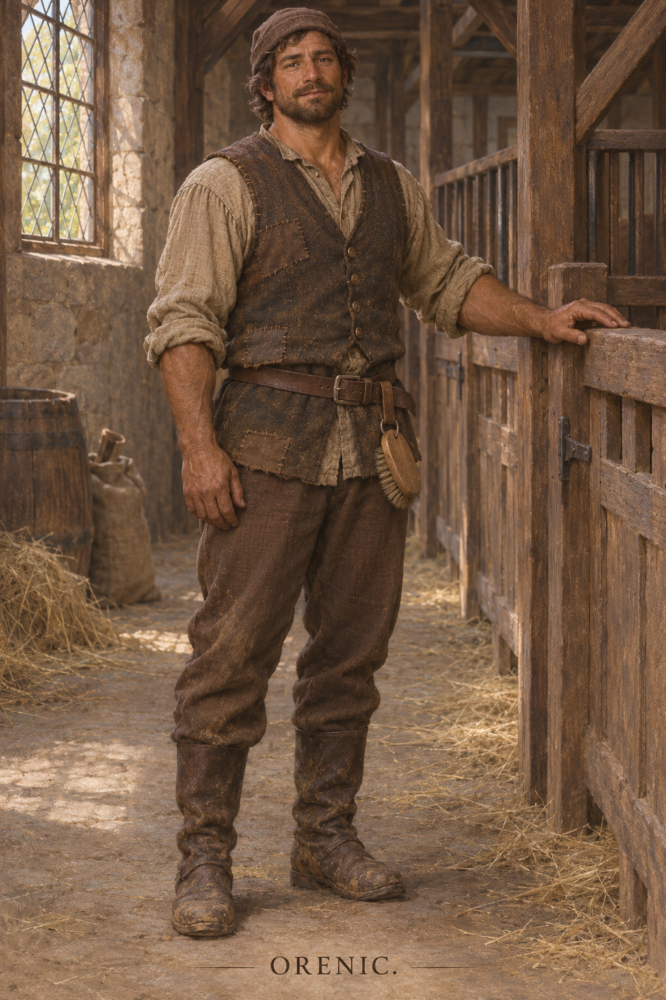

# Orenic

North Return House stable worker; remains free, no established involvement.

## Player-approved character reference design

Approved from the supplied character-sheet draft in [character-reference-design-approval](../../changes/chronicles/character-reference-design-approval.md). The appearance, clothing and mannerisms below are new reference design approved for repository use, not recovered historical observations. They do not establish a sighting, whereabouts, inventory acquisition, guilt, abilities, kinship or past action. Reference ages are design values, not a calendar advance; exact measurements not supplied below remain unspecified.

- **Recorded role and continuity:** North Return House stable worker; free, no established involvement.
- **Sex, ancestry, age, measurements and appearance:** Human male, 37; 5 ft 7 in, 170 lb. Stocky, strong-legged build, weathered bronze skin, hazel eyes. Thick brown hair under wool cap, short beard, broad hands.
- **Clothing and image-reference equipment:** Rough flax shirt, patched vest, sturdy trousers, muddy boots; grooming brush in belt.
- **Personality, mannerisms and speech:** Patient with animals, reserved with strangers. Slow approach, low voice; checks nearby animals before conversation.
- **Historical gaps and boundaries:** Surname, history and later whereabouts.

## Character portrait

[Portrait gallery](../../artwork/character-references/README.md) · [Approved design provenance](../../changes/chronicles/character-reference-design-approval.md). Generated from the approved reference description; incidental visual details and background are artistic interpretation, not additional played facts.
