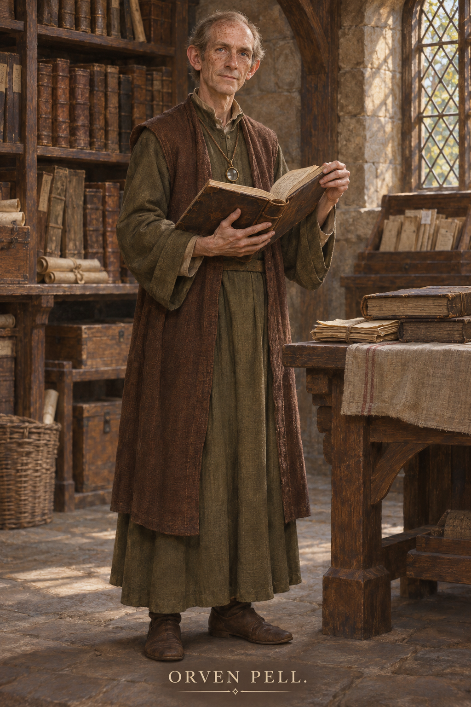

# Orven Pell

Permitted public archive-index examination at old Waykeeper records store.


## Player-approved character reference design

Approved from the supplied character-sheet draft in [character-reference-design-approval](../../changes/chronicles/character-reference-design-approval.md). The appearance, clothing and mannerisms below are new reference design approved for repository use, not recovered historical observations. They do not establish a sighting, whereabouts, inventory acquisition, guilt, abilities, kinship or past action. Reference ages are design values, not a calendar advance; exact measurements not supplied below remain unspecified.

- **Recorded role and continuity:** Permitted public archive-index examination at old Waykeeper records store.
- **Sex, ancestry, age, measurements and appearance:** Human male, 58; 5 ft 6 in, 150 lb. Narrow build, pale freckled skin, blue eyes, prominent ears, long fingers. Sparse sandy-gray hair, clean-shaven.
- **Clothing and image-reference equipment:** Faded olive robe, brown sleeveless overcoat; small reading lens on cord.
- **Personality, mannerisms and speech:** Courteous, orderly, protective of records. Supports book spines, marks places carefully; firm about handling rules.
- **Historical gaps and boundaries:** Formal position, authority, history and whereabouts. Identity with stablemaster Oren Pell is not established.


## Character portrait



[Portrait gallery](../../artwork/character-references/README.md) · [Approved design provenance](../../changes/chronicles/character-reference-design-approval.md). Generated from the approved reference description; incidental visual details and background are artistic interpretation, not additional played facts.


## Character sheet

```yaml
character_sheet:
  id: orven-pell
  name: Orven Pell
  aliases: null
  ancestry: null
  sex: null
  age: null
  role: Waykeeper archive-index examiner contact
  rank: null
  level: null
  hp: null
  hp_max: null
  mp: null
  mp_max: null
  defense: null
  equipped_defense: null
  str: null
  dex: null
  con: null
  int: null
  wis: null
  cha: null
  unspent_attributes: null
  skills:
  - Waykeeper archive access and index handling
  abilities: null
  equipment: null
  mount: null
  personal_cash: null
  relationships: null
  assessment: null
  recorded_context: Permitted public archive-index examination at old Waykeeper records store.
  approved_portrait_reference:
    appearance: Human male, 58; 5 ft 6 in, 150 lb. Narrow build, pale freckled skin, blue eyes, prominent
      ears, long fingers. Sparse sandy-gray hair, clean-shaven.
    clothing: Faded olive robe, brown sleeveless overcoat; small reading lens on cord.
    personality: Courteous, orderly, protective of records. Supports book spines, marks places carefully;
      firm about handling rules.
    gaps: Formal position, authority, history and whereabouts. Identity with stablemaster Oren Pell is
      not established.
    artwork_ref: artwork/character-references/orven-pell.png
  source_refs:
  - entities/characters/orven-pell.md
  - changes/chronicles/character-reference-design-approval.md
```
