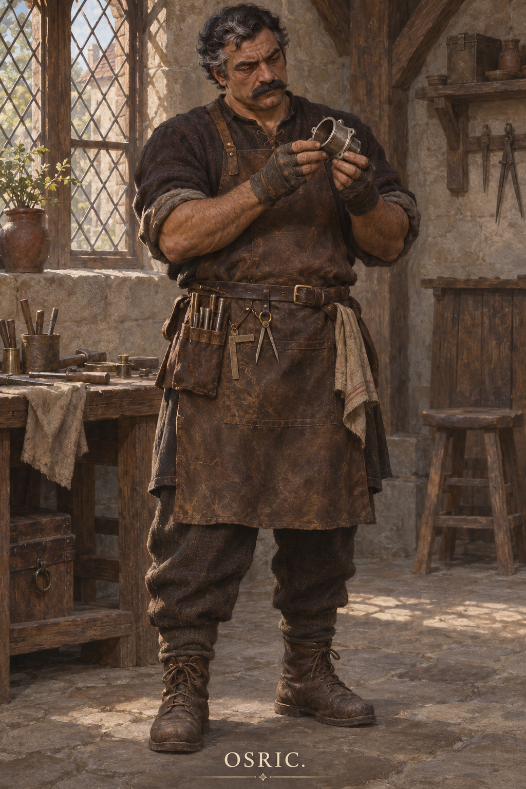

# Osric

Reported ward-housing fitter at western aqueduct workshop beneath broken waterwheel/western span. Reported delivery returned without acknowledgment; workshop stopped responding roughly three days before Corven questioning.


## Player-approved character reference design

Approved from the supplied character-sheet draft in [character-reference-design-approval](../../changes/chronicles/character-reference-design-approval.md). The appearance, clothing and mannerisms below are new reference design approved for repository use, not recovered historical observations. They do not establish a sighting, whereabouts, inventory acquisition, guilt, abilities, kinship or past action. Reference ages are design values, not a calendar advance; exact measurements not supplied below remain unspecified.

- **Recorded role and continuity:** Reported ward-housing fitter at western aqueduct workshop beneath broken waterwheel/western span. Reported delivery returned without acknowledgment; workshop stopped responding roughly three days before Corven questioning.
- **Sex, ancestry, age, measurements and appearance:** Human male, 47; 5 ft 8 in, 190 lb. Thickset, muscular forearms, tawny skin, deep-set amber eyes. Coarse graying black hair, heavy mustache.
- **Clothing and image-reference equipment:** Dark work tunic, reinforced apron, fingerless work gloves, small fitting tools.
- **Personality, mannerisms and speech:** Concentrated, taciturn, sensitive to imprecise workmanship. Rotates parts while listening; brushes metal dust from palms before documents.
- **Historical gaps and boundaries:** Identity, role, involvement, whereabouts and workshop silence unverified. Reference design is not an authenticated description.


## Character portrait



[Portrait gallery](../../artwork/character-references/README.md) · [Approved design provenance](../../changes/chronicles/character-reference-design-approval.md). Generated from the approved reference description; incidental visual details and background are artistic interpretation, not additional played facts.


## Character sheet

```yaml
character_sheet:
  id: osric
  name: Osric
  aliases: null
  ancestry: null
  sex: null
  age: null
  role: Reported ward-housing fitter
  rank: null
  level: null
  hp: null
  hp_max: null
  mp: null
  mp_max: null
  defense: null
  equipped_defense: null
  str: null
  dex: null
  con: null
  int: null
  wis: null
  cha: null
  unspent_attributes: null
  skills: null
  abilities: null
  equipment: null
  mount: null
  personal_cash: null
  relationships: null
  assessment: null
  recorded_context: Reported ward-housing fitter at western aqueduct workshop beneath broken waterwheel/western
    span. Reported delivery returned without acknowledgment; workshop stopped responding roughly three
    days before Corven questioning.
  approved_portrait_reference:
    appearance: Human male, 47; 5 ft 8 in, 190 lb. Thickset, muscular forearms, tawny skin, deep-set amber
      eyes. Coarse graying black hair, heavy mustache.
    clothing: Dark work tunic, reinforced apron, fingerless work gloves, small fitting tools.
    personality: Concentrated, taciturn, sensitive to imprecise workmanship. Rotates parts while listening;
      brushes metal dust from palms before documents.
    gaps: Identity, role, involvement, whereabouts and workshop silence unverified. Reference design is
      not an authenticated description.
    artwork_ref: artwork/character-references/osric.png
  source_refs:
  - entities/characters/osric.md
  - changes/chronicles/character-reference-design-approval.md
  character_design_profile:
    classification: Prospective character design; use recorded facts wherever they exist
    apparent_age_for_art: '38'
    presentation_for_art: masculine-presenting
    visual_ancestry_or_form: humanoid
    appearance: Human male, 47; 5 ft 8 in, 190 lb. Thickset, muscular forearms, tawny skin, deep-set amber eyes.
      Coarse graying black hair, heavy mustache.
    wardrobe_and_props: Dark work tunic, reinforced apron, fingerless work gloves, small fitting tools.
    character_motivation: Wants craft claims judged against actual workmanship. Reported affiliation remains
      unverified.
    practice_and_professional_skills:
    - fitting inspection
    - mechanical alignment
    magic_and_healing: Ordinary nonmagical design. No personal spellcasting assigned.
    abilities_and_techniques:
    - 'Fitting inspection: practical proficiency for roleplay and assessment.'
    unassessed_stat_proposal:
      hp_max: 24
      base_defense: 10
      str: 12
      dex: 11
      con: 12
      int: 12
      wis: 10
      cha: 10
      mp_max: 0
    portrait_reference: artwork/character-references/osric.png
  image_generator_prompt: 'Full-body medieval high fantasy character portrait of Osric, masculine-presenting,
    humanoid. Age presentation: 38. Appearance: Human male, 47; 5 ft 8 in, 190 lb. Thickset, muscular forearms,
    tawny skin, deep-set amber eyes. Coarse graying black hair, heavy mustache. Clothing and posed props: Dark
    work tunic, reinforced apron, fingerless work gloves, small fitting tools. Match the established face, build,
    colors and costume in artwork/character-references/osric.png if supplied as a reference image. Three-quarter
    stance, unobstructed face and hands, even natural light, muted neutral backdrop, realistic fabric and material
    texture. Props are illustrative. No lettering, extra people, active spell effects, hidden symbols, or scene-specific
    location clues.'
```
