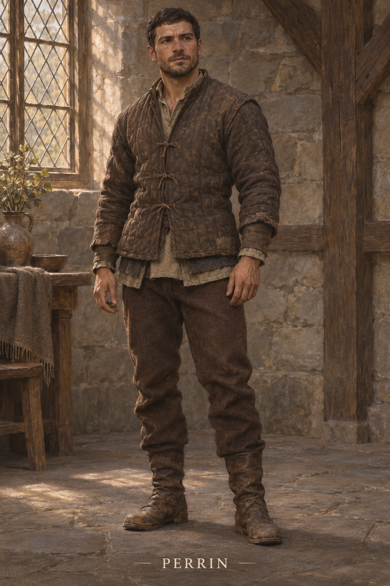

# Perrin

Rear guard at North Return House; cooperatively surrendered and secured unharmed. One of three current expedition detainees, guarded nonlethally by Garrick; no transfer or punishment.


## Player-approved character reference design

Approved from the supplied character-sheet draft in [character-reference-design-approval](../../changes/chronicles/character-reference-design-approval.md). The appearance, clothing and mannerisms below are new reference design approved for repository use, not recovered historical observations. They do not establish a sighting, whereabouts, inventory acquisition, guilt, abilities, kinship or past action. Reference ages are design values, not a calendar advance; exact measurements not supplied below remain unspecified.

- **Recorded role and continuity:** North Return House rear guard; cooperatively surrendered unharmed. Nonlethal Garrick custody at Day124.
- **Sex, ancestry, age, measurements and appearance:** Human male, 32; 5 ft 10 in, 180 lb. Compact sturdy build, medium tan skin, brown eyes, broken-looking nose. Cropped dark brown hair, short stubble.
- **Clothing and image-reference equipment:** Worn padded jack, plain wool layers, scuffed boots. Historical guard depiction may include simple spear and belt knife.
- **Personality, mannerisms and speech:** Practical, responsive to clear danger. Shifts weight, checks colleagues before committing, visibly relaxes with clear instructions.
- **Historical gaps and boundaries:** Employer details, background, individual culpability and later disposition. Depiction equipment does not grant current inventory or rearm a detainee.


## Character portrait



[Portrait gallery](../../artwork/character-references/README.md) · [Approved design provenance](../../changes/chronicles/character-reference-design-approval.md). Generated from the approved reference description; incidental visual details and background are artistic interpretation, not additional played facts.


## Character sheet

```yaml
character_sheet:
  id: perrin
  name: Perrin
  aliases: null
  ancestry: null
  sex: null
  age: null
  role: North Return House rear guard
  rank: null
  level: null
  hp: null
  hp_max: null
  mp: null
  mp_max: null
  defense: null
  equipped_defense: null
  str: null
  dex: null
  con: null
  int: null
  wis: null
  cha: null
  unspent_attributes: null
  skills: null
  abilities: null
  equipment: null
  mount: null
  personal_cash: null
  relationships: null
  assessment: null
  recorded_context: Rear guard at North Return House; cooperatively surrendered and secured unharmed.
    One of three current expedition detainees, guarded nonlethally by Garrick; no transfer or punishment.
  approved_portrait_reference:
    appearance: Human male, 32; 5 ft 10 in, 180 lb. Compact sturdy build, medium tan skin, brown eyes,
      broken-looking nose. Cropped dark brown hair, short stubble.
    clothing: Worn padded jack, plain wool layers, scuffed boots. Historical guard depiction may include
      simple spear and belt knife.
    personality: Practical, responsive to clear danger. Shifts weight, checks colleagues before committing,
      visibly relaxes with clear instructions.
    gaps: Employer details, background, individual culpability and later disposition. Depiction equipment
      does not grant current inventory or rearm a detainee.
    artwork_ref: artwork/character-references/perrin.png
  source_refs:
  - entities/characters/perrin.md
  - changes/chronicles/character-reference-design-approval.md
```
