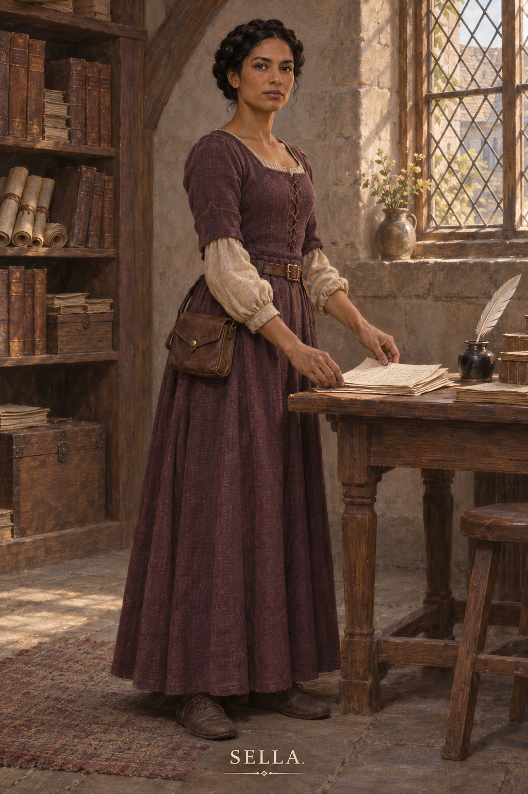

# Sella

North Return House clerk; cooperated voluntarily, remains free. Not a prisoner and no guilt inferred.


## Player-approved character reference design

Approved from the supplied character-sheet draft in [character-reference-design-approval](../../changes/chronicles/character-reference-design-approval.md). The appearance, clothing and mannerisms below are new reference design approved for repository use, not recovered historical observations. They do not establish a sighting, whereabouts, inventory acquisition, guilt, abilities, kinship or past action. Reference ages are design values, not a calendar advance; exact measurements not supplied below remain unspecified.

- **Recorded role and continuity:** North Return House clerk; voluntarily cooperated and remained free; no guilt inferred.
- **Sex, ancestry, age, measurements and appearance:** Human female, 31; 5 ft 5 in, 140 lb. Average build, brown skin, heart-shaped face, dark brown eyes. Black hair in tidy braided crown.
- **Clothing and image-reference equipment:** Muted plum dress, cream sleeves, practical waist pouch; ink-stained fingertips.
- **Personality, mannerisms and speech:** Methodical, observant, composed. Aligns papers before explaining; remembers discrepancies and requests clarification.
- **Historical gaps and boundaries:** Surname, background, complete testimony and later whereabouts. Not established as dockmaster Sella Reed.


## Character portrait



[Portrait gallery](../../artwork/character-references/README.md) · [Approved design provenance](../../changes/chronicles/character-reference-design-approval.md). Generated from the approved reference description; incidental visual details and background are artistic interpretation, not additional played facts.


## Character sheet

```yaml
character_sheet:
  id: sella
  name: Sella
  aliases: null
  ancestry: null
  sex: null
  age: null
  role: North Return House clerk
  rank: null
  level: null
  hp: null
  hp_max: null
  mp: null
  mp_max: null
  defense: null
  equipped_defense: null
  str: null
  dex: null
  con: null
  int: null
  wis: null
  cha: null
  unspent_attributes: null
  skills:
  - Clerical work
  abilities: null
  equipment: null
  mount: null
  personal_cash: null
  relationships: null
  assessment: null
  recorded_context: North Return House clerk; cooperated voluntarily, remains free. Not a prisoner and
    no guilt inferred.
  approved_portrait_reference:
    appearance: Human female, 31; 5 ft 5 in, 140 lb. Average build, brown skin, heart-shaped face, dark
      brown eyes. Black hair in tidy braided crown.
    clothing: Muted plum dress, cream sleeves, practical waist pouch; ink-stained fingertips.
    personality: Methodical, observant, composed. Aligns papers before explaining; remembers discrepancies
      and requests clarification.
    gaps: Surname, background, complete testimony and later whereabouts. Not established as dockmaster
      Sella Reed.
    artwork_ref: artwork/character-references/sella.png
  source_refs:
  - entities/characters/sella.md
  - changes/chronicles/character-reference-design-approval.md
  character_design_profile:
    classification: Prospective character design; use recorded facts wherever they exist
    apparent_age_for_art: '32'
    presentation_for_art: feminine-presenting
    visual_ancestry_or_form: humanoid
    appearance: Human female, 31; 5 ft 5 in, 140 lb. Average build, brown skin, heart-shaped face, dark brown
      eyes. Black hair in tidy braided crown.
    wardrobe_and_props: Muted plum dress, cream sleeves, practical waist pouch; ink-stained fingertips.
    character_motivation: Wants her cooperation accurately represented.
    practice_and_professional_skills:
    - clerical work
    - document organization
    magic_and_healing: Ordinary nonmagical design. No personal spellcasting assigned.
    abilities_and_techniques:
    - 'Clerical work: practical proficiency for roleplay and assessment.'
    unassessed_stat_proposal:
      hp_max: 20
      base_defense: 9
      str: 8
      dex: 11
      con: 10
      int: 14
      wis: 13
      cha: 11
      mp_max: 0
    portrait_reference: artwork/character-references/sella.png
  image_generator_prompt: 'Full-body medieval high fantasy character portrait of Sella, feminine-presenting,
    humanoid. Age presentation: 32. Appearance: Human female, 31; 5 ft 5 in, 140 lb. Average build, brown skin,
    heart-shaped face, dark brown eyes. Black hair in tidy braided crown. Clothing and posed props: Muted plum
    dress, cream sleeves, practical waist pouch; ink-stained fingertips. Match the established face, build,
    colors and costume in artwork/character-references/sella.png if supplied as a reference image. Three-quarter
    stance, unobstructed face and hands, even natural light, muted neutral backdrop, realistic fabric and material
    texture. Props are illustrative. No lettering, extra people, active spell effects, hidden symbols, or scene-specific
    location clues.'
```
