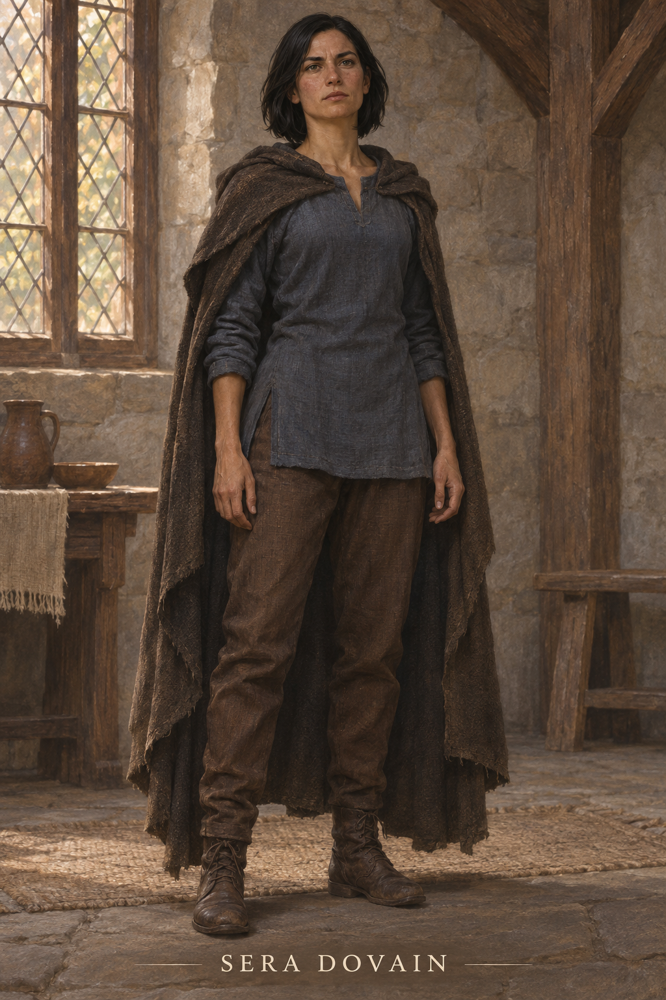

# Sera Dovain

Alive, detained at fortified wagon camp. No transfer or release.

## Player-approved character reference design

Approved from the supplied character-sheet draft in [character-reference-design-approval](../../changes/chronicles/character-reference-design-approval.md). The appearance, clothing and mannerisms below are new reference design approved for repository use, not recovered historical observations. They do not establish a sighting, whereabouts, inventory acquisition, guilt, abilities, kinship or past action. Reference ages are design values, not a calendar advance; exact measurements not supplied below remain unspecified.

- **Recorded role and continuity:** Alive and detained at fortified wagon camp on Year847 Day472.
- **Sex, ancestry, age, measurements and appearance:** Human female, 34; 5 ft 7 in, 145 lb. Wiry build, warm olive skin, high cheekbones, dark green eyes. Straight black hair just below jaw.
- **Clothing and image-reference equipment:** Plain slate-blue tunic, brown trousers, worn dark cloak; practical rather than ornamental.
- **Personality, mannerisms and speech:** Self-contained, attentive, economical speech. Steady gaze, presses lips before disagreement; sits upright when tired.
- **Historical gaps and boundaries:** Occupation, affiliation, detention grounds, testimony and later disposition.

## Character portrait

[Portrait gallery](../../artwork/character-references/README.md) · [Approved design provenance](../../changes/chronicles/character-reference-design-approval.md). Generated from the approved reference description; incidental visual details and background are artistic interpretation, not additional played facts.
