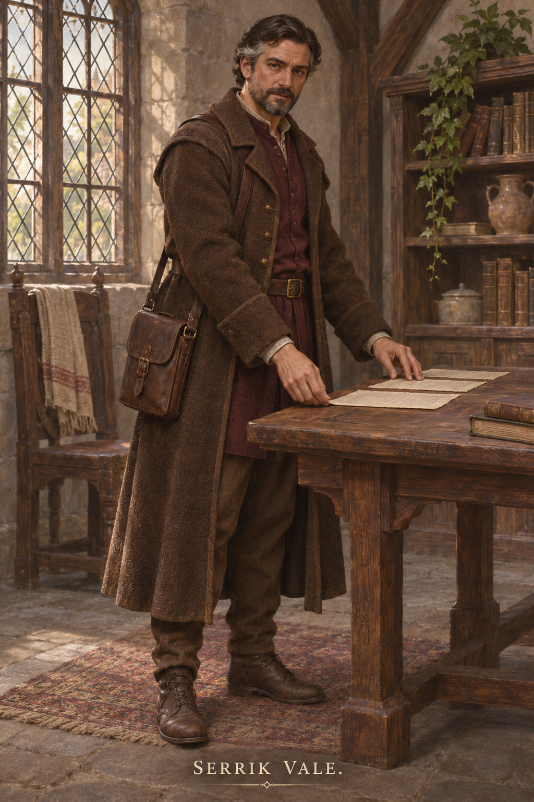

# Serrik Vale

Supplied distribution records and agreed to corrections; original Crown bounty contracts/amounts remain unverified. No payment established.


## Player-approved character reference design

Approved from the supplied character-sheet draft in [character-reference-design-approval](../../changes/chronicles/character-reference-design-approval.md). The appearance, clothing and mannerisms below are new reference design approved for repository use, not recovered historical observations. They do not establish a sighting, whereabouts, inventory acquisition, guilt, abilities, kinship or past action. Reference ages are design values, not a calendar advance; exact measurements not supplied below remain unspecified.

- **Recorded role and continuity:** Supplied distribution records and agreed to corrections; original Crown bounty contracts/amounts remain unverified. No payment established.
- **Sex, ancestry, age, measurements and appearance:** Human male, 40; 5 ft 11 in, 180 lb. Average build with slight middle-aged softness. Warm beige skin, brown eyes, broad nose. Dark chestnut hair graying at temples, neatly trimmed beard.
- **Clothing and image-reference equipment:** Well-maintained brown wool coat, muted burgundy tunic, leather document case, practical boots.
- **Personality, mannerisms and speech:** Businesslike, articulate, accuracy-conscious. Checks figures before defending them, arranges documents sequentially; restrained formal acceptance of corrections.
- **Historical gaps and boundaries:** Formal occupation, earlier history, exact records/corrections and whether corrections completed. No kinship with other Vales established.


## Character portrait



[Portrait gallery](../../artwork/character-references/README.md) · [Approved design provenance](../../changes/chronicles/character-reference-design-approval.md). Generated from the approved reference description; incidental visual details and background are artistic interpretation, not additional played facts.


## Character sheet

```yaml
character_sheet:
  id: serrik-vale
  name: Serrik Vale
  aliases: null
  ancestry: null
  sex: null
  age: null
  role: Distribution records source
  rank: null
  level: null
  hp: null
  hp_max: null
  mp: null
  mp_max: null
  defense: null
  equipped_defense: null
  str: null
  dex: null
  con: null
  int: null
  wis: null
  cha: null
  unspent_attributes: null
  skills: null
  abilities: null
  equipment: null
  mount: null
  personal_cash: null
  relationships: null
  assessment: null
  recorded_context: Supplied distribution records and agreed to corrections; original Crown bounty contracts/amounts
    remain unverified. No payment established.
  approved_portrait_reference:
    appearance: Human male, 40; 5 ft 11 in, 180 lb. Average build with slight middle-aged softness. Warm
      beige skin, brown eyes, broad nose. Dark chestnut hair graying at temples, neatly trimmed beard.
    clothing: Well-maintained brown wool coat, muted burgundy tunic, leather document case, practical
      boots.
    personality: Businesslike, articulate, accuracy-conscious. Checks figures before defending them, arranges
      documents sequentially; restrained formal acceptance of corrections.
    gaps: Formal occupation, earlier history, exact records/corrections and whether corrections completed.
      No kinship with other Vales established.
    artwork_ref: artwork/character-references/serrik-vale.png
  source_refs:
  - entities/characters/serrik-vale.md
  - changes/chronicles/character-reference-design-approval.md
  character_design_profile:
    classification: Prospective character design; use recorded facts wherever they exist
    apparent_age_for_art: '43'
    presentation_for_art: masculine-presenting
    visual_ancestry_or_form: humanoid
    appearance: Human male, 40; 5 ft 11 in, 180 lb. Average build with slight middle-aged softness. Warm beige
      skin, brown eyes, broad nose. Dark chestnut hair graying at temples, neatly trimmed beard.
    wardrobe_and_props: Well-maintained brown wool coat, muted burgundy tunic, leather document case, practical
      boots.
    character_motivation: Wants his records corrected through a transparent process.
    practice_and_professional_skills:
    - distribution records
    - checking corrections
    magic_and_healing: Ordinary nonmagical design. No personal spellcasting assigned.
    abilities_and_techniques:
    - 'Distribution records: practical proficiency for roleplay and assessment.'
    unassessed_stat_proposal:
      hp_max: 20
      base_defense: 9
      str: 8
      dex: 11
      con: 10
      int: 14
      wis: 13
      cha: 11
      mp_max: 0
    portrait_reference: artwork/character-references/serrik-vale.png
  image_generator_prompt: 'Full-body medieval high fantasy character portrait of Serrik Vale, masculine-presenting,
    humanoid. Age presentation: 43. Appearance: Human male, 40; 5 ft 11 in, 180 lb. Average build with slight
    middle-aged softness. Warm beige skin, brown eyes, broad nose. Dark chestnut hair graying at temples, neatly
    trimmed beard. Clothing and posed props: Well-maintained brown wool coat, muted burgundy tunic, leather
    document case, practical boots. Match the established face, build, colors and costume in artwork/character-references/serrik-vale.png
    if supplied as a reference image. Three-quarter stance, unobstructed face and hands, even natural light,
    muted neutral backdrop, realistic fabric and material texture. Props are illustrative. No lettering, extra
    people, active spell effects, hidden symbols, or scene-specific location clues.'
```
