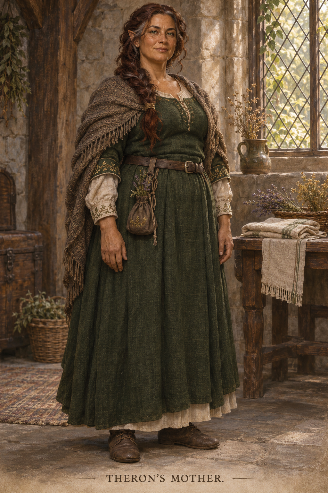

# Theron's mother — Day156 current canon

Informed on return Year848 Suncrest36 Day156; family safe at home. No invented intervening travel or additional outcome.


## Historical record before Day156 (superseded only where explicit above)


# Theron's mother

Rare sacred healer; mother of Theron and Lyanna. Later correction places her at home at Ashvale Estate with Aric, superseding older unknown-location wording.


## Player-approved character reference design

Approved from the supplied character-sheet draft in [character-reference-design-approval](../../changes/chronicles/character-reference-design-approval.md). The appearance, clothing and mannerisms below are new reference design approved for repository use, not recovered historical observations. They do not establish a sighting, whereabouts, inventory acquisition, guilt, abilities, kinship or past action. Reference ages are design values, not a calendar advance; exact measurements not supplied below remain unspecified.

- **Recorded role and continuity:** Rare sacred healer; mother of Theron and Lyanna. Later correction places her at home at Ashvale Estate with Aric, superseding older unknown-location wording.
- **Sex, ancestry, age, measurements and appearance:** Elven female; apparent age late 40s, chronological age unresolved. 5 ft 4 in, 175 lb, softly rounded build. Warm golden-brown skin, oval face, green eyes. Long dark auburn hair with a few silver strands, loosely braided.
- **Clothing and image-reference equipment:** Comfortable forest-green and cream layers, embroidered cuffs, practical shawl, small herb pouch; no unestablished holy insignia.
- **Personality, mannerisms and speech:** Warm, steady, perceptive. Gives people time to speak, careful movement around pain; unusually precise wording when displeased.
- **Historical gaps and boundaries:** Name, chronological age, ancestry details, training, exact healing capabilities and history. Elven appearance is approved design, not recovered maternal genealogy.


## Character portrait



[Portrait gallery](../../artwork/character-references/README.md) · [Approved design provenance](../../changes/chronicles/character-reference-design-approval.md). Generated from the approved reference description; incidental visual details and background are artistic interpretation, not additional played facts.

## Year 851 later session

Spent time with Theron and assisted the Day 365 festival medical team.

## Year 852 close

Medical director of supervised healing-wing care. Staffing generally supports up to three concurrent patients, with the fourth bed available when staffing permits. [Session evidence](../../changes/chronicles/year852-day365-end-session.md)

## Year 853 session

Continue the healing wing, medical supply management and estate care. Expansion remains proposed. Sylmerath expressed interest in voluntary medicinal collaboration.


## Character sheet

```yaml
character_sheet:
  id: therons-mother
  name: Theron's mother
  aliases: null
  ancestry: Elf
  sex: Female
  age: null
  role: Sacred healer
  rank: null
  level: null
  hp: null
  hp_max: null
  mp: null
  mp_max: null
  defense: null
  equipped_defense: null
  str: null
  dex: null
  con: null
  int: null
  wis: null
  cha: null
  unspent_attributes: null
  skills: null
  abilities:
  - Rare sacred healing
  equipment: null
  mount: null
  personal_cash: null
  relationships:
    children:
    - theron-ashvale
    - lyanna-ashvale
  assessment: null
  recorded_context: Theron and Lyanna’s mother, an established sacred healer. Last confirmed at Ashvale
    Estate with Aric.
  identity_note: Personal name and chronological age unverified.
  approved_portrait_reference:
    appearance: Elven female; apparent age late 40s, chronological age unresolved. 5 ft 4 in, 175 lb,
      softly rounded build. Warm golden-brown skin, oval face, green eyes. Long dark auburn hair with
      a few silver strands, loosely braided.
    clothing: Comfortable forest-green and cream layers, embroidered cuffs, practical shawl, small herb
      pouch; no unestablished holy insignia.
    personality: Warm, steady, perceptive. Gives people time to speak, careful movement around pain; unusually
      precise wording when displeased.
    gaps: Name, chronological age, ancestry details, training, exact healing capabilities and history.
      Elven appearance is approved design, not recovered maternal genealogy.
    artwork_ref: artwork/character-references/therons-mother.png
  capability_evidence:
    mana_evidence: Sacred healing is established. Personal resource mechanism, maximum and current
      amount unverified.
    established_abilities:
    - Rare sacred healing
  proposed_assessment:
    status: Proposed; requires approval before play
    specialties:
    - Supervised restorative care
    - Stabilization assessment
  source_refs:
  - entities/characters/therons-mother.md
  - changes/chronicles/character-reference-design-approval.md
  - archive/legacy-modules/world/07-7-the-ashvale-family.md
  - entities/mechanics/independent-assignments.md
  - entities/locations/ashvale-estate.md
  last_reported_location: Ashvale Estate
```
