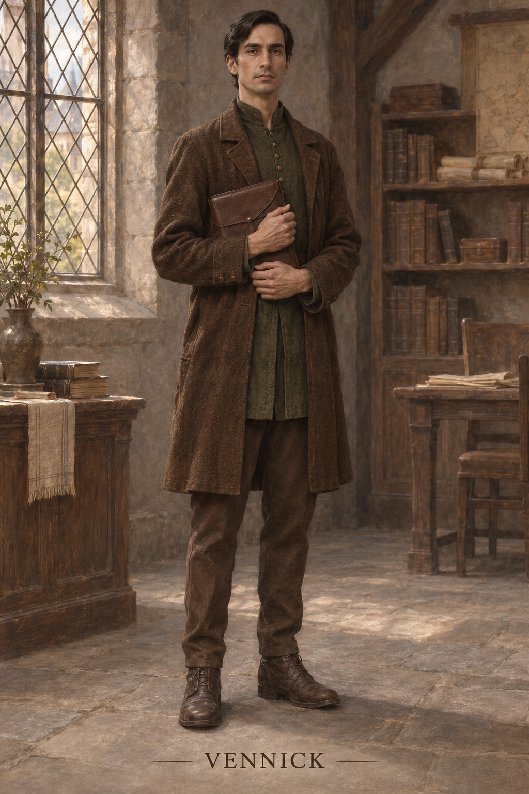

# Vennick

Reportedly Seventh Office clerk handling unknown Acting Receiver's messages; receiving rooms west of Seventh Bell lower foundations, near covered stairs below fallen aqueduct.


## Player-approved character reference design

Approved from the supplied character-sheet draft in [character-reference-design-approval](../../changes/chronicles/character-reference-design-approval.md). The appearance, clothing and mannerisms below are new reference design approved for repository use, not recovered historical observations. They do not establish a sighting, whereabouts, inventory acquisition, guilt, abilities, kinship or past action. Reference ages are design values, not a calendar advance; exact measurements not supplied below remain unspecified.

- **Recorded role and continuity:** Reportedly Seventh Office clerk handling unknown Acting Receiver's messages; receiving rooms west of Seventh Bell lower foundations, near covered stairs below fallen aqueduct.
- **Sex, ancestry, age, measurements and appearance:** Human male, 36; 5 ft 9 in, 155 lb. Slender build, light olive skin, narrow nose, gray-brown eyes. Neatly side-parted straight dark hair; clean-shaven.
- **Clothing and image-reference equipment:** Unremarkable dark green clerk's tunic, brown coat, document wallet.
- **Personality, mannerisms and speech:** Precise, professionally impersonal. Repeats names/dates for confirmation, keeps papers close, rarely interrupts.
- **Historical gaps and boundaries:** Reported role, identity, involvement and location independently unverified. Reference design is not a confirmed sighting.


## Character portrait



[Portrait gallery](../../artwork/character-references/README.md) · [Approved design provenance](../../changes/chronicles/character-reference-design-approval.md). Generated from the approved reference description; incidental visual details and background are artistic interpretation, not additional played facts.


## Character sheet

```yaml
character_sheet:
  id: vennick
  name: Vennick
  aliases: null
  ancestry: null
  sex: null
  age: null
  role: Reported Seventh Office clerk
  rank: null
  level: null
  hp: null
  hp_max: null
  mp: null
  mp_max: null
  defense: null
  equipped_defense: null
  str: null
  dex: null
  con: null
  int: null
  wis: null
  cha: null
  unspent_attributes: null
  skills: null
  abilities: null
  equipment: null
  mount: null
  personal_cash: null
  relationships: null
  assessment: null
  recorded_context: Reportedly Seventh Office clerk handling unknown Acting Receiver's messages; receiving
    rooms west of Seventh Bell lower foundations, near covered stairs below fallen aqueduct.
  approved_portrait_reference:
    appearance: Human male, 36; 5 ft 9 in, 155 lb. Slender build, light olive skin, narrow nose, gray-brown
      eyes. Neatly side-parted straight dark hair; clean-shaven.
    clothing: Unremarkable dark green clerk's tunic, brown coat, document wallet.
    personality: Precise, professionally impersonal. Repeats names/dates for confirmation, keeps papers
      close, rarely interrupts.
    gaps: Reported role, identity, involvement and location independently unverified. Reference design
      is not a confirmed sighting.
    artwork_ref: artwork/character-references/vennick.png
  source_refs:
  - entities/characters/vennick.md
  - changes/chronicles/character-reference-design-approval.md
  character_design_profile:
    classification: Prospective character design; use recorded facts wherever they exist
    apparent_age_for_art: '37'
    presentation_for_art: masculine-presenting
    visual_ancestry_or_form: humanoid
    appearance: Human male, 36; 5 ft 9 in, 155 lb. Slender build, light olive skin, narrow nose, gray-brown
      eyes. Neatly side-parted straight dark hair; clean-shaven.
    wardrobe_and_props: Unremarkable dark green clerk's tunic, brown coat, document wallet.
    character_motivation: Wants discretion in conversation. His reported role remains unverified.
    practice_and_professional_skills:
    - message sorting
    - office procedure
    magic_and_healing: Ordinary nonmagical design. No personal spellcasting assigned.
    abilities_and_techniques:
    - 'Message sorting: practical proficiency for roleplay and assessment.'
    unassessed_stat_proposal:
      hp_max: 20
      base_defense: 9
      str: 8
      dex: 11
      con: 10
      int: 14
      wis: 13
      cha: 11
      mp_max: 0
    portrait_reference: artwork/character-references/vennick.png
  image_generator_prompt: 'Full-body medieval high fantasy character portrait of Vennick, masculine-presenting,
    humanoid. Age presentation: 37. Appearance: Human male, 36; 5 ft 9 in, 155 lb. Slender build, light olive
    skin, narrow nose, gray-brown eyes. Neatly side-parted straight dark hair; clean-shaven. Clothing and posed
    props: Unremarkable dark green clerk''s tunic, brown coat, document wallet. Match the established face,
    build, colors and costume in artwork/character-references/vennick.png if supplied as a reference image.
    Three-quarter stance, unobstructed face and hands, even natural light, muted neutral backdrop, realistic
    fabric and material texture. Props are illustrative. No lettering, extra people, active spell effects, hidden
    symbols, or scene-specific location clues.'
```
